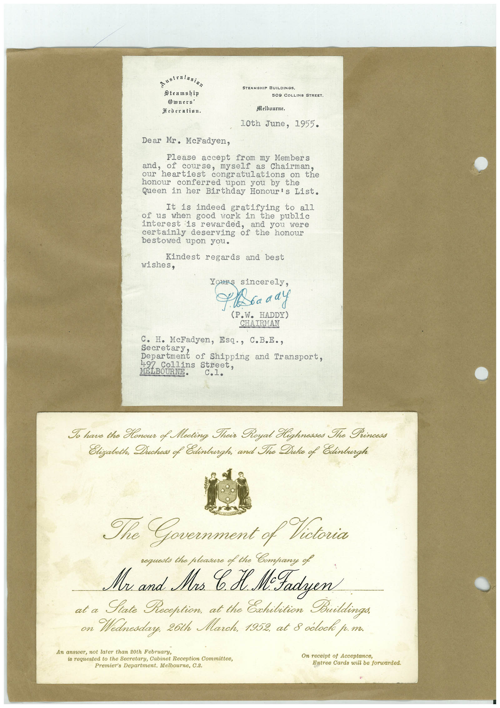

# Book 1 · scan 123

[Original scan](../../images/book-1/large/JPEG/BOOK1%20-%20124.jpg)

## Description

## Transcription

## Context

## Review notes

Compare the machine draft with the scan. Handwriting and names need human review.

## Artifacts

<!-- ARTIFACTS:START -->
Edit the artifacts field in this note’s frontmatter to change these records. This summary is generated.

### B01-S123-A01 — Letter & Invitation — Book 1, scan 123

Types: Typed document, Letter, Invitation

Scope: Whole scanned page; individual items can be split out during review.

Caption: Not mapped yet.

Caption source: Not recorded yet.

Caption status: unmapped
<!-- ARTIFACTS:END -->

## Machine transcription

<!-- OCR:START -->
australasian
Steamship
Diners'
Hederatian.
STEAMSHIP BUILDINGS.
509 COLLINS STREET.
Melbourne,
10th June, 1955.
Dear Mr. McFadyen,
Please accept from my Members
of course, myself as Chairman,
our neartlest congratulations on the
honour conferred upon you by the
Queen in her Birthday Honour's List.
It is indeed gratifying to all
of us when good work in the public
interest is rewarded, and you were
certainly deserving of the honour
bestowed upon you.
Kindest
wishes,
regards and best
ours sincerely,
(P.W. HADDY)
CHAIRMAN
C. H. McFadyen, Esq., C.B.E.,
Separtment of shipping and Transport,
497 Collins Street.
MELBOURNE.
C.1.
Io have the Honour of Meeting Their Royal Kighnesses The Princess
Elizabeth, Duchess of Edinburgh; and The Duke of Edinburgh
32
The Government of Victoria
requests the pleasure of the Company of
Mr and Mrs CH. M-Fadyen
at a
Fate Reception, at the Exhibition Buildings,
on Wednesday, 26th March, 1952, at 8 odocke p.m.
An answer, not later than 20th February,
is requested to the Secretary, Cabinet Reception Committee,
Premier's Department. Melbourne, C.2.
On receipt of Acceptance,
Entree Cards will be forwarded.
<!-- OCR:END -->
