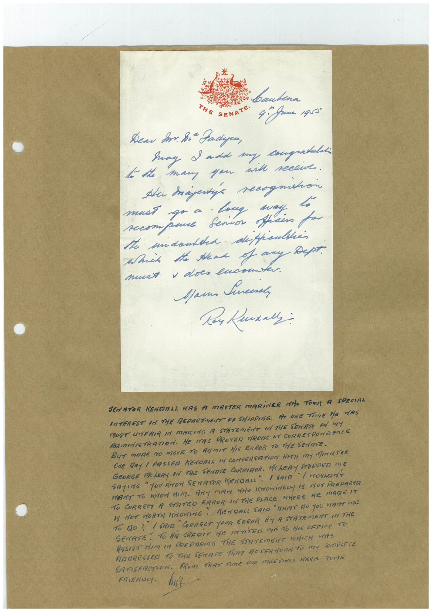

# Book 1 · scan 124

[Original scan](../../images/book-1/large/JPEG/BOOK1%20-%20125.jpg)

## Description

## Transcription

## Context

## Review notes

Compare the machine draft with the scan. Handwriting and names need human review.

## Artifacts

<!-- ARTIFACTS:START -->
Edit the artifacts field in this note’s frontmatter to change these records. This summary is generated.

### B01-S124-A01 — Letter & Handwritten note — Book 1, scan 124

Types: Letter, Handwritten note

Scope: Whole scanned page; individual items can be split out during review.

Caption: Not mapped yet.

Caption source: Not recorded yet.

Caption status: unmapped
<!-- ARTIFACTS:END -->

## Machine transcription

<!-- OCR:START -->
baubena
THE
SENATE•
4. Jame 1q55"
Дели S. 8i- Fadyen,
Say I add my congratuldi
to the man you and recowe.
He trajetie recognition
must go a long may.
secompane Senior officino po
the undoubted deppeltes
Such the Head of any
- Дерт.
must + does encouns
Mann Sincere,
SENATOR KENDALL WAS A MASTER MARiNER HAO TORN A SPECIAL
INTEREST IN THE REDARTMENT DF SHIPPING. AT ONE TIME HE HAS
MOST UNFRIR IN MAKING A STATEmENT IN ThE SEnATe On my
RAMINISTRATION. ME HAS PROVER TRONG IN CORRESPONR ENCTE
BUT MAGE NO MOrE TO RAMIT HIS FRROR TO THE SENATE.
GEORGE MOLERY ON THE SENATE CORRIOR. ME HERY SPIEG NE
ONE DRY 1 PASSED KENDALL IN CONVERSATION HITH MY MINISTER
SAYING " YOU INOW SENATOR NENDALL". / SAIR
HANT TO KNOW HIM. ANY MAN WHO KNOWINGLY IS NOT PREDARED
TO CORRECT A STATEO ERROR IN THE PLACE MHERE HE MADE IT
15 NOT WORTH INORING.
" KENDALL SAID "HAT DO YOU WANT MIE
To tO ?" I SAIA
"CORRECT YOUR ERROR BY A STATEMENT IN THE
SENATE" TO HiS CREDIT ME INTiTER ME TO HIS OFFICe TO
ASSIST HIM IN PREPARING THE STATEMENT WHICH WAS
ANDRESSED TO THE SENATE THAT AFTERNOON TO MY COmPLETE
SATISFACTION. FROM THAT TIME DUR MEETINES HERE qUITE
FRIENDLY.
<!-- OCR:END -->
