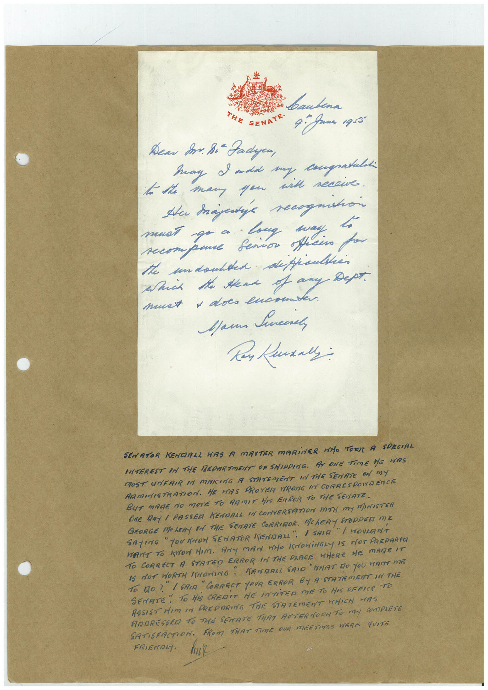

# Book 1 · scan 125

[Original scan](../../images/book-1/large/JPEG/BOOK1%20-%20126.jpg)

## Description

## Transcription

## Context

## Review notes

Compare the machine draft with the scan. Handwriting and names need human review.

## Artifacts

<!-- ARTIFACTS:START -->
Edit the artifacts field in this note’s frontmatter to change these records. This summary is generated.

### B01-S125-A01 — Letter & Handwritten note — Book 1, scan 125

Types: Letter, Handwritten note

Scope: Whole scanned page; individual items can be split out during review.

Caption: Not mapped yet.

Caption source: Not recorded yet.

Caption status: unmapped
<!-- ARTIFACTS:END -->

## Machine transcription

<!-- OCR:START -->
bautena
THE
SENATE•
4. game agra
Дем So. Bi Padyen,
Say I add my congratuld
to the many you with recewe.
must go a Long say.
compane Senior officio for
the undoubted difficulties
Which the send of any Дерт.
must , does lucou
Mau Sneere
SENATOR KENDALL WAS A MASTER MARINER WHO TOOT A
SPECIAL
INTEREST IN THE MEDARTMENT DE SHIPPING. AT ONE TIME HE MAS
MOST UNFAIR IN MAKING A STATEmENT IN THE SEnATe An mY
RAMINISTRATION. HE HAS PROYER RONG IN CORRESPONDENCE
BUT MAGE NO MOrE TO ARMIT HIS ERROR TO THE SENATE.
ONE DRY I PASSED KENDALL IN CONVERSATION HITH MY MARISTER
GEORGE MOLERY EN THE SENATE CORRIOR. MCLERY STOPPED ME
SAYING " YOU KNOW SENATOR KENDALL". 1 SAIG
"I WOULANT
WANT TO KON HIM. ANY MAN WHO KNOWiNGLY IS NOT PREDARED
TO CORRECT A STATEO ERROR IN THE PLACE WHERE HE MARE IT
IS NOT HORTH (SNORING" KENDRLL SAIG"HHAT DO YOU WANT MI
To DO? " I SAIA " CORRECT YOUR ERROR BY A STATEMENT IN THE
SENATE •
" TO HiS CREDIT HE INTiTER ME TO HIS OFFICe TO
ASSIST HIM IN PREPARING THE STATEMENT WHICH WAS
ANARESSED TO THE SENATE THAT AFTERNOON TO MY COmPLETE
SATISFACTION.
FROM THAT TIME OUR MEETINGS WERE qUITE
FRIENDLY.
<!-- OCR:END -->
