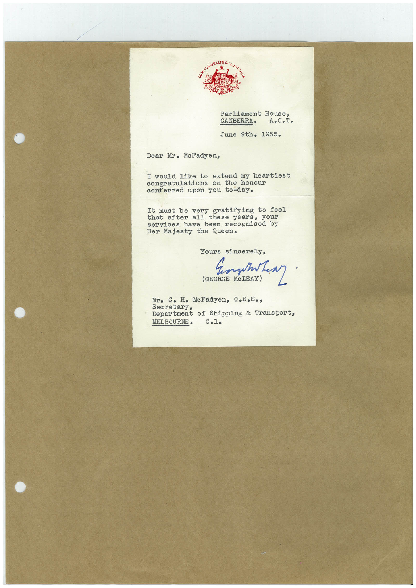

# Book 1 · scan 126

[Original scan](../../images/book-1/large/JPEG/BOOK1%20-%20127.jpg)

## Description

## Transcription

## Context

## Review notes

Compare the machine draft with the scan. Handwriting and names need human review.

## Artifacts

<!-- ARTIFACTS:START -->
Edit the artifacts field in this note’s frontmatter to change these records. This summary is generated.

### B01-S126-A01 — Letter — Book 1, scan 126

Types: Typed document, Letter

Scope: Whole scanned page; individual items can be split out during review.

Caption: Not mapped yet.

Caption source: Not recorded yet.

Caption status: unmapped
<!-- ARTIFACTS:END -->

## Machine transcription

<!-- OCR:START -->
ParLiament House
CANBERRA•
June 9th. 1955.
Dear Mr. McFadyen,
I would like to extend my heartiest
congratulations on the honour
conferred upon jou to-day•
It must be very gratifying to feel
that
after
all these years, your
services have been recognised by
Her Majesty the Queen.
Yours sincerely,
(GEORGE McLEAY)
Sensitter.
Mr. C. H. McFadyen, C.B.E•,
secretary,
Department of Shipping & Transport,
MELBOURNE •
C.1.
<!-- OCR:END -->
