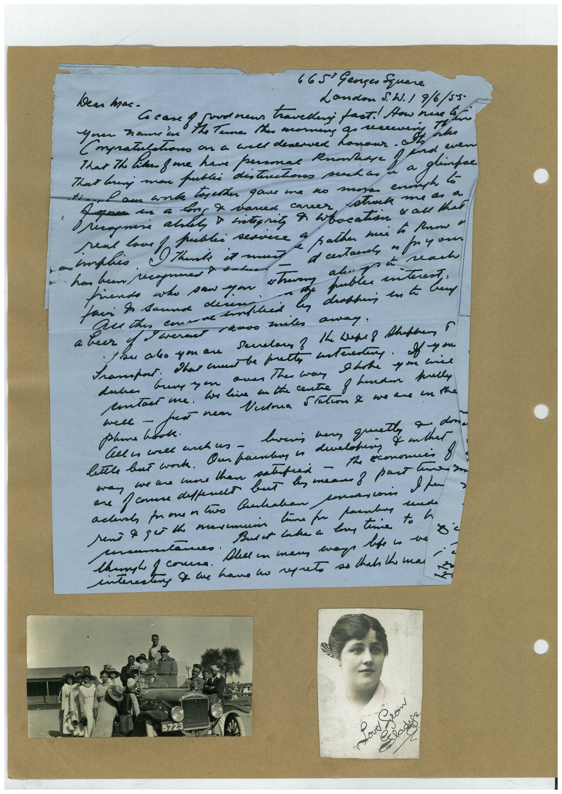

# Book 1 · scan 128

[Original scan](../../images/book-1/large/JPEG/BOOK1%20-%20129.jpg)

## Description

## Transcription

## Context

## Review notes

Compare the machine draft with the scan. Handwriting and names need human review.

## Artifacts

<!-- ARTIFACTS:START -->
Edit the artifacts field in this note’s frontmatter to change these records. This summary is generated.

### B01-S128-A01 — Letter, Photo & Handwritten note — Book 1, scan 128

Types: Letter, Photo, Handwritten note

Scope: Whole scanned page; individual items can be split out during review.

Caption: Not mapped yet.

Caption source: Not recorded yet.

Caption status: unmapped
<!-- ARTIFACTS:END -->

## Machine transcription

<!-- OCR:START -->
Dea mac-
665° Ganges Square
Landon 5. W. / 9/6/55.
That branj man pablo destrons senhas
Tar Th Pra fae ter paramo Benner agita
a gasa en a ter E vanes cares atrul me as a
« all that
hiendo who paw ya
a heer of Para reado antes aray.
tsu alo yu au
saber
Gene yon ou The wan Stthe
conta me. We lia en the centre o hander melly
pline hook.
1 dona
we ao mune than satafred -
and
em time to
<!-- OCR:END -->
