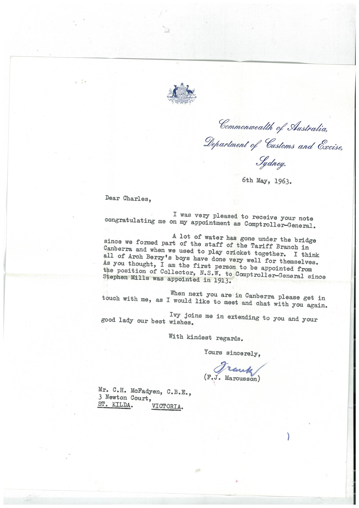

# Book 1 · scan 129

[Original scan](../../images/book-1/large/JPEG/BOOK1%20-%20130.jpg)

## Description

## Transcription

## Context

## Review notes

Compare the machine draft with the scan. Handwriting and names need human review.

## Artifacts

<!-- ARTIFACTS:START -->
Edit the artifacts field in this note’s frontmatter to change these records. This summary is generated.

### B01-S129-A01 — Letter — Book 1, scan 129

Types: Typed document, Letter

Scope: Whole scanned page; individual items can be split out during review.

Caption: Not mapped yet.

Caption source: Not recorded yet.

Caption status: unmapped
<!-- ARTIFACTS:END -->

## Machine transcription

<!-- OCR:START -->
Commonwealth of Australia,
Department of Customs and Excise,
Sydney.
6th May, 1963.
Dear Charles,
I was very pleased to receive your note
congratulating
me on my appointment as Comptroller-General.
A lot of water has gone under the bridge
since we formed part of the staff of the Tariff Branch in
Canberra and when we used to play cricket together.
all of Arch Berry's boys have done very well for themselves.
As you thought, I am the first person to be appointed from
the position of Collector, N.S.W. to Comptroller-General since
Stephen Mills was appointed in 1913.
When next you are in Canberra please get in
touch with me, as I would like to meet and chat with you again.
Ivy joins me in extending to you and your
good lady our best wishes.
With kindest regards.
Yours sincerely,
Trauk
(F.J. Marcusson)
Mr. C.H. McFadyen, C.B.E.,
3 Newton Court,
ST. KILDA.
VICTORIA.
<!-- OCR:END -->
