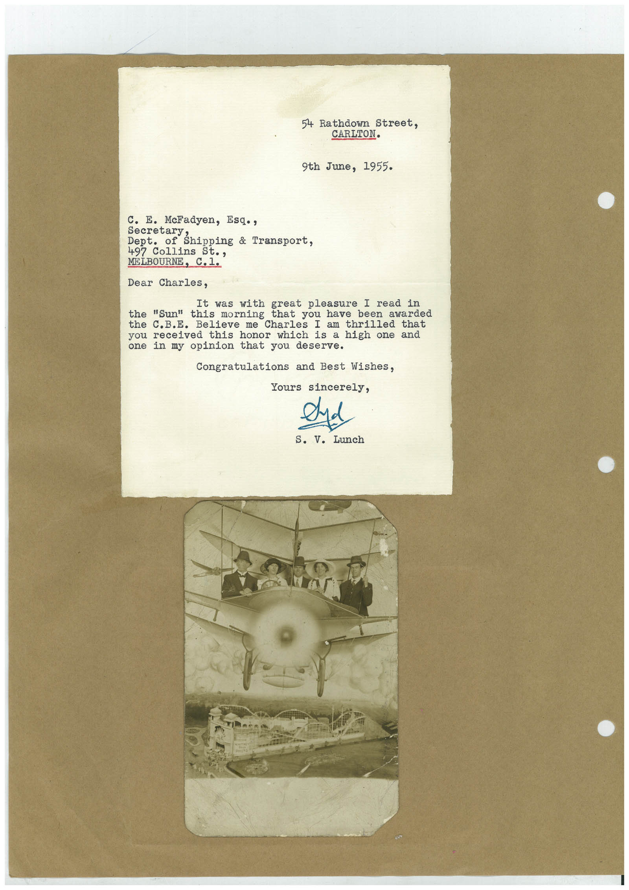

# Book 1 · scan 130

[Original scan](../../images/book-1/large/JPEG/BOOK1%20-%20131.jpg)

## Description

## Transcription

## Context

## Review notes

Compare the machine draft with the scan. Handwriting and names need human review.

## Artifacts

<!-- ARTIFACTS:START -->
Edit the artifacts field in this note’s frontmatter to change these records. This summary is generated.

### B01-S130-A01 — Letter & Photo — Book 1, scan 130

Types: Typed document, Letter, Photo

Scope: Whole scanned page; individual items can be split out during review.

Caption: Not mapped yet.

Caption source: Not recorded yet.

Caption status: unmapped
<!-- ARTIFACTS:END -->

## Machine transcription

<!-- OCR:START -->
54 Rathdown Street,
CARLTON.
9th June, 1955.
c. E. McFadyen, Esq.,
Secretar Shipping & Transport,
Dept. of
497 Collins St.,
MELBOURNE, C.1.
Dear Charles,
It was with great pleasure I read in
"Sun" this morning that you have been awarded
the C.B.E. Believe me Charles I am thrilled
received this honor which is a high one and
one in my opinion that you deserve.
Congratulations and Best Wishes,
Yours sincerely,
s. V. Lunch
<!-- OCR:END -->
