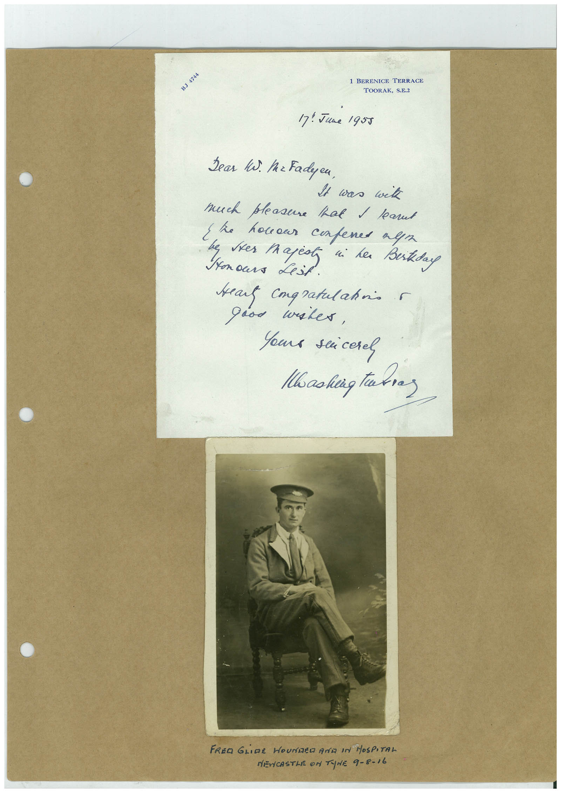

# Book 1 · scan 131

[Original scan](../../images/book-1/large/JPEG/BOOK1%20-%20132.jpg)

## Description

## Transcription

## Context

## Review notes

Compare the machine draft with the scan. Handwriting and names need human review.

## Artifacts

<!-- ARTIFACTS:START -->
Edit the artifacts field in this note’s frontmatter to change these records. This summary is generated.

### B01-S131-A01 — Letter, Photo & Handwritten note — Book 1, scan 131

Types: Letter, Photo, Handwritten note

Scope: Whole scanned page; individual items can be split out during review.

Caption: Not mapped yet.

Caption source: Not recorded yet.

Caption status: unmapped
<!-- ARTIFACTS:END -->

## Machine transcription

<!-- OCR:START -->
BJ 4744
1 BERENICE TERRACE
TOORAK, S.E.2
17: June 1955
Bear ki. IrFadyeu,
It was wik
much pleasure that I kant
{he
honour compened nym
Nonours Lest
si he Berkday
seat congratulahris r
good water,
Yours seicerel
Hooking thes
FRED GLiDE HOUNDED AND IN HOSPITAL
NEWCASTLE ON TUNE 9-8-16
<!-- OCR:END -->
