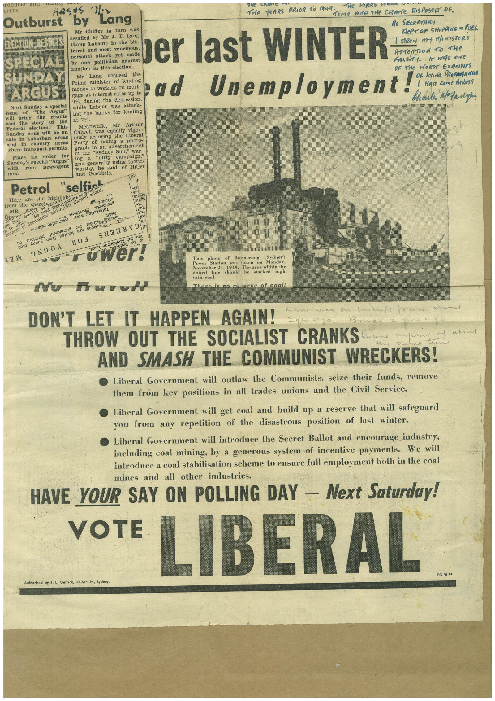

# Book 1 · scan 132

[Original scan](../../images/book-1/large/JPEG/BOOK1%20-%20133.jpg)

## Description

## Transcription

## Context

## Review notes

Compare the machine draft with the scan. Handwriting and names need human review.

## Artifacts

<!-- ARTIFACTS:START -->
Edit the artifacts field in this note’s frontmatter to change these records. This summary is generated.

### B01-S132-A01 — Newspaper clipping — Book 1, scan 132

Types: Newspaper clipping

Scope: Whole scanned page; individual items can be split out during review.

Caption: Not mapped yet.

Caption source: Not recorded yet.

Caption status: unmapped
<!-- ARTIFACTS:END -->

## Machine transcription

<!-- OCR:START -->
Outburst
sasts Lang
by
Mr Chifley in turn was
TrIO YeARS PRIOR TO 1949. me AViD THe CRANE ROSROSeN OF.
As SECRETARY
RePT OF SHIPPING 9 FUEL
ELECTION RESULTS
assailed by Mr J. T. Lang
(Lang Labour) in the bit-
terest and most venemous,
SPECIAL
SUNDAY
ARGUS
Next Sunday a special
sche
will
"The
Argus"
bring
the
results
and the
the
Federal
election.
This
Sunday issue will be on
sale in suburban
area:
and
in
country
areas
where transport permits.
Place
an
order
for
Sunday's special "Argus"
with
newsagent
ELOW
personal attack yet made
by one politician against
ber last WINTER
ArTerition to The
another in this election.
OF THE WORST EXAMIPRES
Mr
Lang
accused
the
Prime Minister of lending
money to workers on mort-
gage at interest rates up to
bad Unemploymenta
9% during the depression,
while Labour was attack-
ing the banks for lending
at 7%.
Meanwhile,
Mr Arthur
Calwell was equally
vigor-
ously accusing the Liberal
Party of faking a photo-
graph in an advertisement
in the "Sydney Sun," wag-
ing
"dirty
campaign,"
and generally using tactics
worthy, he said, of Hitler
and Goebbels.
Petrol "selfish
added.
Here are the highligek-
from the speechenur
samaros
MR
Jo
number
TO!S
Taut
sole super
101
ruwer!
No Harold
This photo
of Bunnerong
Power
Station
(Sydney)
Pover Ser 21, 1919.
dotted
The area within the
line
shoutic
stacked
high
with coal.
There is no reserve of coal!
DON'T LET IT HAPPEN AGAIN!
THROW OUT THE SOCIALIST CRANKS
AND SMASH THE COMMUNIST WRECKERS!
• Liberal Government will outlaw the Communists, seize their funds, remove
them from key positions in all trades unions and the Civil Service.
• Liberal Government will get coal and build up a reserve that will safeguard
you from any repetition of the disastrous position of last winter.
• Liberal Government will introduce the Secret Ballot and encourage industry,
including coal mining, by a generous system of incentive payments. We will
introduce a coal stabilisation scheme to ensure full employment both in the coal
mines and all other industries.
HAVE YOUR SAY ON POLLING DAY - Next Saturday!
VOTE
LIBERAL
FG.50.FP
Authorised by J. L. Carrick, 30 Ash St., Sydney.
<!-- OCR:END -->
