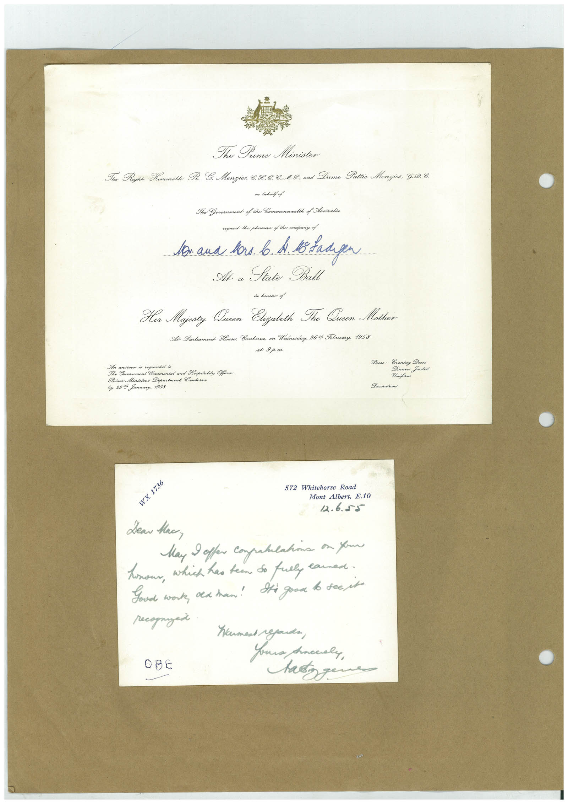

# Book 1 · scan 133

[Original scan](../../images/book-1/large/JPEG/BOOK1%20-%20134.jpg)

## Description

## Transcription

## Context

## Review notes

Compare the machine draft with the scan. Handwriting and names need human review.

## Artifacts

<!-- ARTIFACTS:START -->
Edit the artifacts field in this note’s frontmatter to change these records. This summary is generated.

### B01-S133-A01 — Invitation & Letter — Book 1, scan 133

Types: Invitation, Letter

Scope: Whole scanned page; individual items can be split out during review.

Caption: Not mapped yet.

Caption source: Not recorded yet.

Caption status: unmapped
<!-- ARTIFACTS:END -->

## Machine transcription

<!-- OCR:START -->
The Time Minister
The Right Homourable R. E. Menzics, B.I. C.C..1.9. and Dume Pattie Mengies, G.98.
one lehalf of
The Government of the Commonwealth of Australia
request the ploasuse of the company of
lon and bars. b. A B Baagen
At a Sate Ba
in honour of
Her Majesty Queen Elizalith The Queen Mother
Al Parliament House. Canberra, on Wednesday, 26t Foruary, 1958
at 9p.m.
in andiver is sequeated
a Government Ceremonial and Hospitality Offo
Prime Ministers Department Cankera
by 29% Junuary, 1958
Dress: Evening Dress
Dinner Jacket
Uniform
Decorations
WX 1736
572
Whitehorse Road
Mont Albert, E.10
12.6.55
Lear Hac,
May offer compatulations on your
honour, which has teen so full lawned.
Goud work, old han! Sti good to see it
recognized
OBE
Koument regards,
Anocaly,
as your
<!-- OCR:END -->
