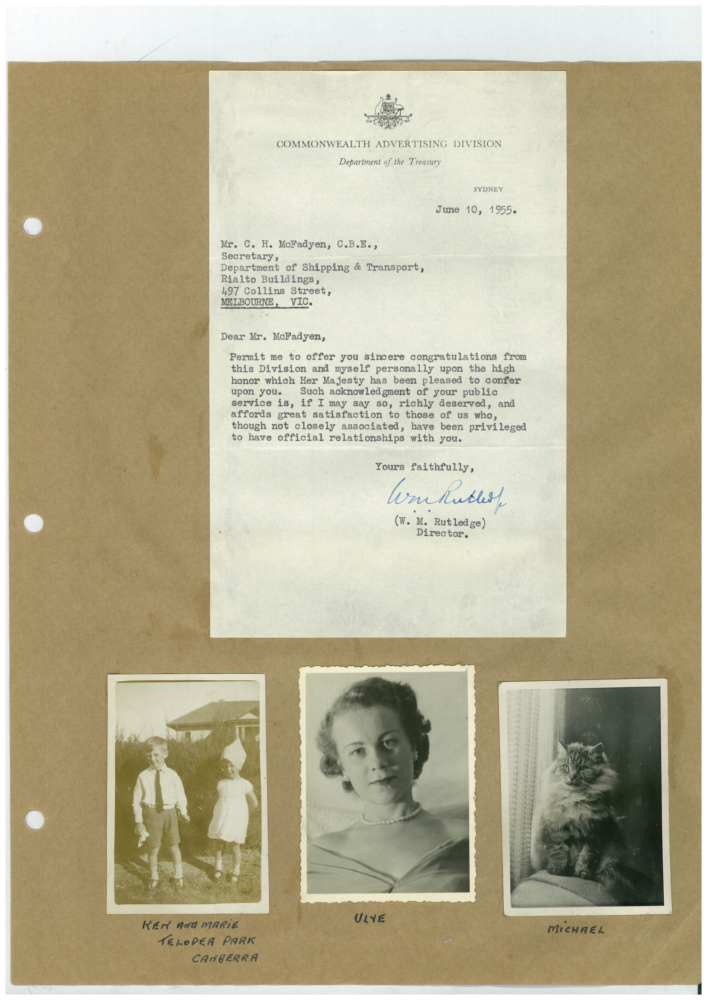

# Book 1 · scan 134

[Original scan](../../images/book-1/large/JPEG/BOOK1%20-%20135.jpg)

## Description

## Transcription

## Context

## Review notes

Compare the machine draft with the scan. Handwriting and names need human review.

## Artifacts

<!-- ARTIFACTS:START -->
Edit the artifacts field in this note’s frontmatter to change these records. This summary is generated.

### B01-S134-A01 — Letter, Photo & Handwritten note — Book 1, scan 134

Types: Typed document, Letter, Photo, Handwritten note

Scope: Whole scanned page; individual items can be split out during review.

Caption: Not mapped yet.

Caption source: Not recorded yet.

Caption status: unmapped
<!-- ARTIFACTS:END -->

## Machine transcription

<!-- OCR:START -->
COMMONWEALTH ADVERTISING DIVISION
Department of the Treasury
SYDNEY
June 10, 1955.
Mr. C. H. McFadyen, C.B.E•,
Secretary,
Department of Shipping & Transport,
Rialto Buildings,
497 Collins Street,
Dear Mr. McFadyen,
Permit me to offer you sincere congratulations from
this Division and myself personally upon the high
honor which Her Majesty has been pleased to confer
Such acknowledgment of your public
service is, if I may say so, richly deserved, and
affords great satisfaction to those of us who,
though not closely associated, have been privileged
to have official relationships with you.
Yours faithfully,
(W. M. Rutledge)
Director.
ULYE
KEN AND MARIE
TELOPER PARK
CANBERRA
MiCHAEL
<!-- OCR:END -->
