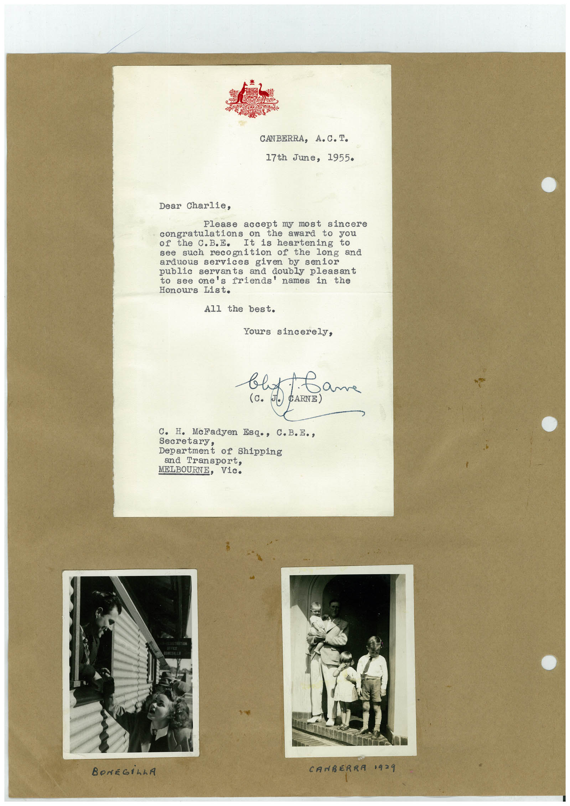

# Book 1 · scan 135

[Original scan](../../images/book-1/large/JPEG/BOOK1%20-%20136.jpg)

## Description

## Transcription

## Context

## Review notes

Compare the machine draft with the scan. Handwriting and names need human review.

## Artifacts

<!-- ARTIFACTS:START -->
Edit the artifacts field in this note’s frontmatter to change these records. This summary is generated.

### B01-S135-A01 — Letter, Photo & Handwritten note — Book 1, scan 135

Types: Typed document, Letter, Photo, Handwritten note

Scope: Whole scanned page; individual items can be split out during review.

Caption: Not mapped yet.

Caption source: Not recorded yet.

Caption status: unmapped
<!-- ARTIFACTS:END -->

## Machine transcription

<!-- OCR:START -->
CANBERRA, A.C. I•
17th June, 1955
Dear Charlie,
accept my most sincere
congratulations on
the award to you
It is heartening
arduous services given by senior
and doubly pleasant
to see one's friends' names in the
All the best.
Yours sincerely,
that
1. Came
(с. Л.)
CARNE)
C. H. MeFadyen Esq., C.B.E.,
Secretary,
Department of Shippins
and Transport,
MELBOURNE, Vie.
BONEGİLLA
CANBERRA 1939
<!-- OCR:END -->
