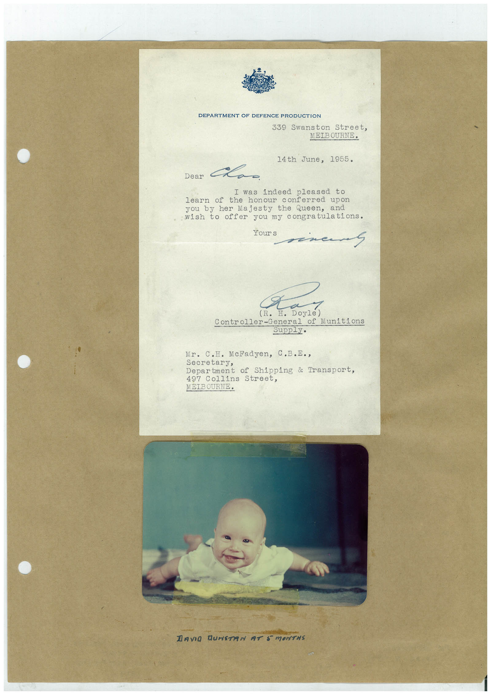

# Book 1 · scan 136

[Original scan](../../images/book-1/large/JPEG/BOOK1%20-%20137.jpg)

## Description

## Transcription

## Context

## Review notes

Compare the machine draft with the scan. Handwriting and names need human review.

## Artifacts

<!-- ARTIFACTS:START -->
Edit the artifacts field in this note’s frontmatter to change these records. This summary is generated.

### B01-S136-A01 — Letter & Photo — Book 1, scan 136

Types: Typed document, Letter, Photo

Scope: Whole scanned page; individual items can be split out during review.

Caption: Not mapped yet.

Caption source: Not recorded yet.

Caption status: unmapped
<!-- ARTIFACTS:END -->

## Machine transcription

<!-- OCR:START -->
DEPARTMENT OF DEFENCE PRODUCTION
339
Swanston Street,
MEIBOURNE.
14th June, 1955.
Dear
I was indeed pleased to
learn of the honour conferred upon
you by her Majesty the Queen, and
wish to offer you my congratulations.
Your s
(R.
Controller-General of Munitions
Supply.
Mr. C.H. McFadyen, C.B.E.,
Secretary,
Department of Shipping & Transport,
497 Collins Street,
MEIBOURNE•
DAVIO GUNSTAIN AT 5 mONTHS
<!-- OCR:END -->
