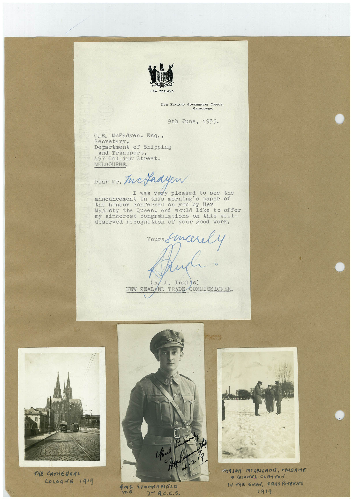

# Book 1 · scan 137

[Original scan](../../images/book-1/large/JPEG/BOOK1%20-%20138.jpg)

## Description

## Transcription

## Context

## Review notes

Compare the machine draft with the scan. Handwriting and names need human review.

## Artifacts

<!-- ARTIFACTS:START -->
Edit the artifacts field in this note’s frontmatter to change these records. This summary is generated.

### B01-S137-A01 — Letter & Photo — Book 1, scan 137

Types: Typed document, Letter, Photo

Scope: Whole scanned page; individual items can be split out during review.

Caption: Not mapped yet.

Caption source: Not recorded yet.

Caption status: unmapped
<!-- ARTIFACTS:END -->

## Machine transcription

<!-- OCR:START -->
NEW ZEALAND
NEW ZEALAND GOVERNMENT OFFICE,
MELBOURNE.
9th June, 1955.
C. E. McFadyen, Esq.,
Secretary,
Department of Shipping
and Transport,
497 Collins Street,
MELBOURNE.
Dear Mr.
tuckadyen
was very pleased to see the
announcement in this morning's paper of
the honour conferred on you by Her
Majesty the Queen, and would like to offer
my sincerest congraulations on this well-
deserved recognition of your good work.
Pluck!
NEW ZEAL
ND TRADE COMMISSIONER.
19,
THE CATHEGRAL
COLOGNE 1919
vy.o.
20 A.C.C.S.
TRAJOR MOLELLADO, PIRARME
• COLONEL CLATTOr
IN THE SMON, SARS POTERIES
1919
<!-- OCR:END -->
