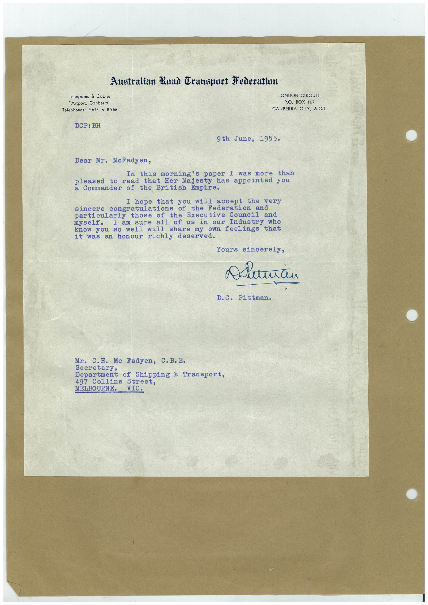

# Book 1 · scan 138

[Original scan](../../images/book-1/large/JPEG/BOOK1%20-%20139.jpg)

## Description

## Transcription

## Context

## Review notes

Compare the machine draft with the scan. Handwriting and names need human review.

## Artifacts

<!-- ARTIFACTS:START -->
Edit the artifacts field in this note’s frontmatter to change these records. This summary is generated.

### B01-S138-A01 — Letter — Book 1, scan 138

Types: Typed document, Letter

Scope: Whole scanned page; individual items can be split out during review.

Caption: Not mapped yet.

Caption source: Not recorded yet.

Caption status: unmapped
<!-- ARTIFACTS:END -->

## Machine transcription

<!-- OCR:START -->
Australian Ruad Gransport Federation
Telegrams & Cables
"Artport, Canberra"
Telephones: F673 & B 965
DCP: BH
LONDON CIRCUIT.
P.O. BOX 167
CANBERRA CITY, A.C.T.
9th June, 1955.
Dear Mr. McFadyen,
In this morning's paper I was more than
pleased to read that Her Majesty has appointed you
a Commander of the British Empire.
I hope that you will accept the very
sincere congratulations of the Federation and
particularly those of the Executive Council and
I am sure all of us in our Industry who
know you so well will share my own feelings that
it was an honour richly deserved.
Yours sincerely,
Alieman
D.C. Pittman.
Mr. C.H. Mc Fadyen, C.B.E.
Department of Shipping & Transport,
497 Collins Street,
MELBOURNE. VIC.
<!-- OCR:END -->
