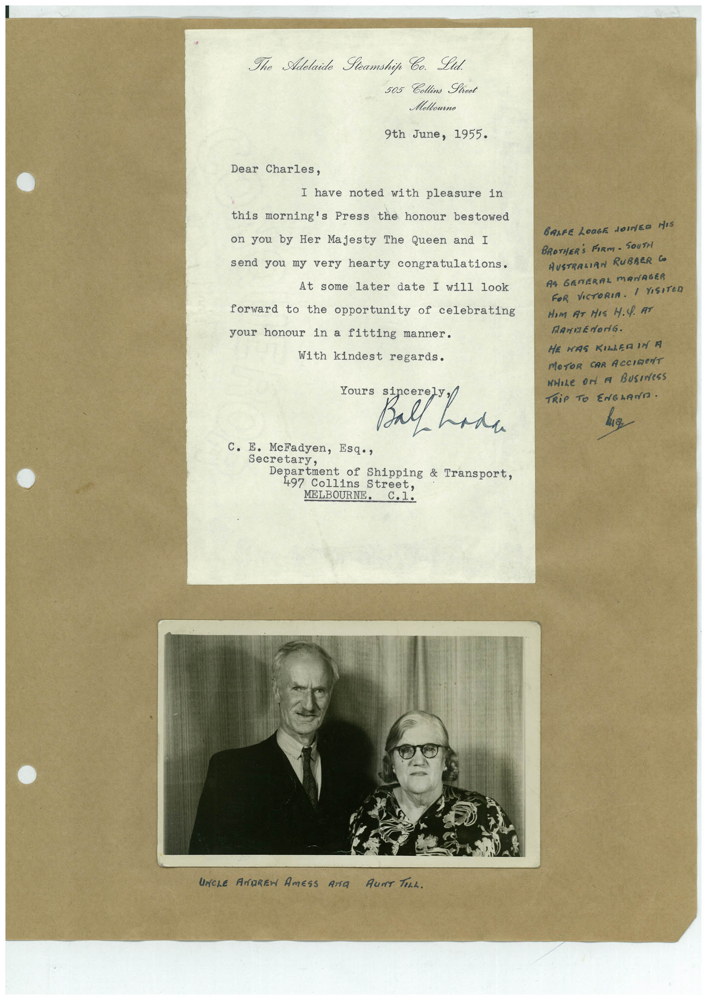

# Book 1 · scan 139

[Original scan](../../images/book-1/large/JPEG/BOOK1%20-%20140.jpg)

## Description

## Transcription

## Context

## Review notes

Compare the machine draft with the scan. Handwriting and names need human review.

## Artifacts

<!-- ARTIFACTS:START -->
Edit the artifacts field in this note’s frontmatter to change these records. This summary is generated.

### B01-S139-A01 — Letter, Photo & Handwritten note — Book 1, scan 139

Types: Typed document, Letter, Photo, Handwritten note

Scope: Whole scanned page; individual items can be split out during review.

Caption: Not mapped yet.

Caption source: Not recorded yet.

Caption status: unmapped
<!-- ARTIFACTS:END -->

## Machine transcription

<!-- OCR:START -->
The Adolaide Steamship Co. Ltd.
505 Collins Street
Meltourne
9th June, 1955.
Dear Charles,
I have noted with pleasure in
this morning's Press the honour bestowed
on you by Her Majesty The Queen and I
send you my very hearty congratulations.
At some later date I will 100k
forward to the opportunity of celebrating
your honour in a fitting manner.
With kindest regards.
ours sincer
Ball had
C. E. McFadyen, Esq.,
Secretary,
Department of Shipping & Transport,
497 Collins Street,
MELBOURNE. C.1.
UNCLE ANDREW AmESS Ara
AunT TeLL.
BARFE LONGE JOINED HIS
BROTHER'S FIRM- SOUTH
AUSTRALIRN RUBARR CO
AS GENERAL MANAGER
FOR VICTORIA. I VISITeD
HIm AT HIs H.Q. AT
RANGEdOriG.
HE WAS KILLER IN M
MOTOR CAR ACCIDeNT
WHILe On A BUSINeSS
TRiP TO ENGLAND.
<!-- OCR:END -->
