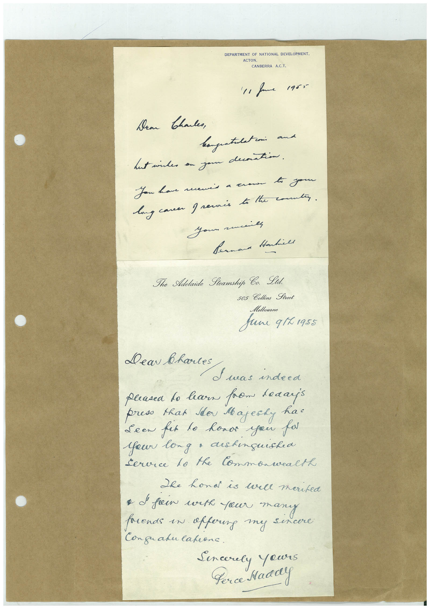

# Book 1 · scan 140

[Original scan](../../images/book-1/large/JPEG/BOOK1%20-%20141.jpg)

## Description

## Transcription

## Context

## Review notes

Compare the machine draft with the scan. Handwriting and names need human review.

## Artifacts

<!-- ARTIFACTS:START -->
Edit the artifacts field in this note’s frontmatter to change these records. This summary is generated.

### B01-S140-A01 — Letter & Handwritten note — Book 1, scan 140

Types: Letter, Handwritten note

Scope: Whole scanned page; individual items can be split out during review.

Caption: Not mapped yet.

Caption source: Not recorded yet.

Caption status: unmapped
<!-- ARTIFACTS:END -->

## Machine transcription

<!-- OCR:START -->
DEPARTMENT OF NATIONAL DEVELOPMENT.
ACTON.
CANBERRA A.C.T.
'11 fame 1955
Dear
thales,
hagustlation and
Lust indes an you contin.
You have newis a crown to your
long caver greenis to the comman.
шиль
Joun a
Bernard Hankill
The Adelaide Seamship Ca. Lid.
505 Collins Street
Melbourno
June q1L1955
Dear bartes S was indeed
pleasea to hearn from leaaris
press that Ider Majesky hat
Seen fat to honor you par
Your long a dishinguished
Service lo the Commonwealth
She hond is wall merited
• d fein with your many
rends in affoung my sincere
Conguanulation.
Sencerely yours
Perce Maddy
<!-- OCR:END -->
