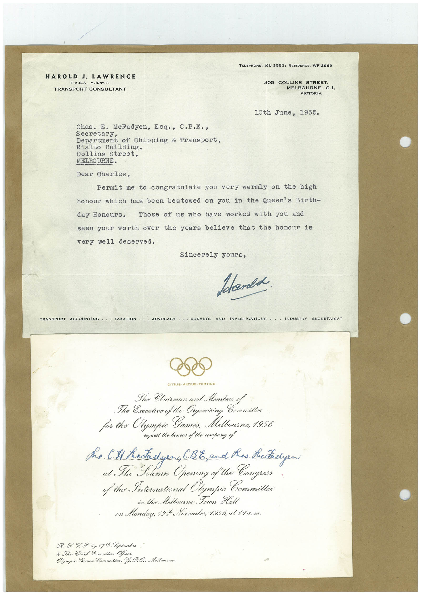

# Book 1 · scan 141

[Original scan](../../images/book-1/large/JPEG/BOOK1%20-%20142.jpg)

## Description

## Transcription

## Context

## Review notes

Compare the machine draft with the scan. Handwriting and names need human review.

## Artifacts

<!-- ARTIFACTS:START -->
Edit the artifacts field in this note’s frontmatter to change these records. This summary is generated.

### B01-S141-A01 — Letter & Invitation — Book 1, scan 141

Types: Typed document, Letter, Invitation

Scope: Whole scanned page; individual items can be split out during review.

Caption: Not mapped yet.

Caption source: Not recorded yet.

Caption status: unmapped
<!-- ARTIFACTS:END -->

## Machine transcription

<!-- OCR:START -->
HAROLD J. LAWRENCE
F.A.S.A.; M.INST.T.
TRANSPORT CONSULTANT
TELEPHONE: MU 3552: RESIDENCE. WF 2969
405 COLLINS STREET.
MELBOURNE. C.1.
VICTORIA
10th June, 1955.
Chas. E. McFadyen, Esq., C.B.E.,
Secretary,
Department of Shipping & Transport,
Rialto Building,
Collins Street,
MELBOURNE•
Dear Charles,
Permit me to congratulate you very warmly on the high
honour which has been bestowed on you in the Queen's Birth-
day Honours.
Those of us who have worked with you and
seen your worth over the years believe that the honour is
very well deserved.
Sincerely yours,
Stands
TRANSPORT ACCOUNIING ••• LAXATION
•ADVOGACY
SURVEYS AND INVESTIGATIONS
INDUSTRY SECRETARIAT
CITIUS • ALTIUS • FORTIUS
The Chairman and Members of
The Oxecutive of the Organising
for the Olympic Games, Melbourne, 1956
request the honour of the company of
Ms. CS Metadyen, C.%, and thas Shetadyew
at The Solemn Opening of the Congross
f the International Olympic Committee
in the Melbourne Sown Halt
on Monduy, 191 November, 1956, at 11a.m.
R. I.% I. by 17 t Soptember,
to The Chief Executive Officer
Olympic Games Committee, G. P.O.. Melbourne
<!-- OCR:END -->
