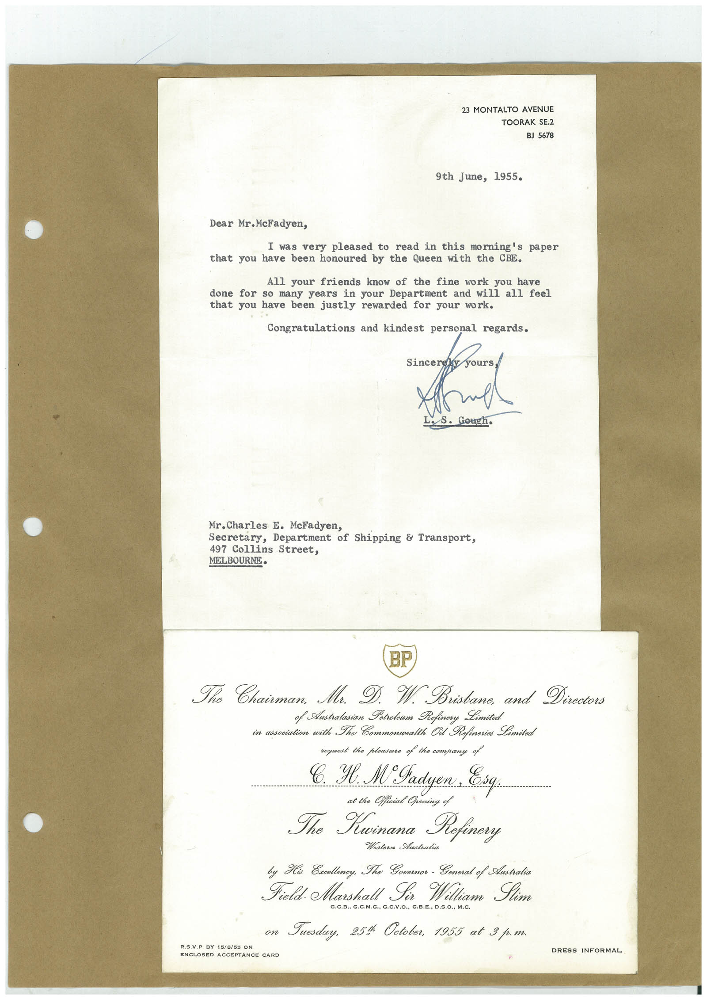

# Book 1 · scan 142

[Original scan](../../images/book-1/large/JPEG/BOOK1%20-%20143.jpg)

## Description

## Transcription

## Context

## Review notes

Compare the machine draft with the scan. Handwriting and names need human review.

## Artifacts

<!-- ARTIFACTS:START -->
Edit the artifacts field in this note’s frontmatter to change these records. This summary is generated.

### B01-S142-A01 — Letter & Invitation — Book 1, scan 142

Types: Typed document, Letter, Invitation

Scope: Whole scanned page; individual items can be split out during review.

Caption: Not mapped yet.

Caption source: Not recorded yet.

Caption status: unmapped
<!-- ARTIFACTS:END -->

## Machine transcription

<!-- OCR:START -->
23 MONTALTO AVENUE
TOORAK SE.2
BJ 5678
9th June, 1955.
Dear Mr. McFadyen,
I was very pleased to read in this morning's paper
that you have been honoured by the Queen with the CBE.
All your friends know of the fine work you have
done for so many years in your Department and will all feel
that you have been justly rewarded for your work.
Congratulations and kindest personal regards.
Sincerel
yours
Mr. Charles I. McFadyen,
Secretary, Department of Shipping & Transport,
497 Collins Street,
MELBOURNE•
BP
The Chairman.
Mr.
D.
W. Brisbane, and Directors
of Australasian Potroleum Refinery Limited
in association with The Commonwealth Oil Refineries Limited
request the pleasure of the company of
Yl. M°Jadyen.
at the Official Opening of
To Krinana
Refinery
Western Australia
by His Exollenoy, The Govornor - General of Australia
Field. Marshall Sir William Slim
G.C.B.. G.C.M.G., G.C.V.O., G.B.E., D.S.O., M.C.
on Tuesduy, 2514 Ootober, 1955 at 3 p.m.
R.S.V.P BY 15/8/55 ON
DRESS INFORMAL
ENCLOSED ACCEPTANCE CARD
<!-- OCR:END -->
