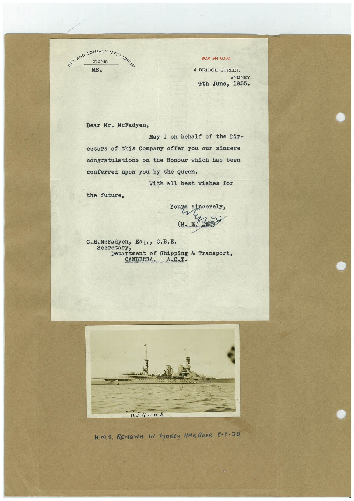

# Book 1 · scan 143

[Original scan](../../images/book-1/large/JPEG/BOOK1%20-%20144.jpg)

## Description

## Transcription

## Context

## Review notes

Compare the machine draft with the scan. Handwriting and names need human review.

## Artifacts

<!-- ARTIFACTS:START -->
Edit the artifacts field in this note’s frontmatter to change these records. This summary is generated.

### B01-S143-A01 — Letter & Photo — Book 1, scan 143

Types: Typed document, Letter, Photo

Scope: Whole scanned page; individual items can be split out during review.

Caption: Not mapped yet.

Caption source: Not recorded yet.

Caption status: unmapped
<!-- ARTIFACTS:END -->

## Machine transcription

<!-- OCR:START -->
HE HO CORN I LATE
SYDNEY
MS.
BOX 544 G.P.O.
4 BRIDGE STREET,
SYDNEY.
9th June, 1955.
Dear Mr. McFadyen,
May I on behalf of the Dir-
ectors of this Company offer you our sincere
congratulations on the Honour which has been
conferred upon you by the Queen.
With all best wishes for
the future,
(W. ES
c.H. McFadyen, Esq., C.B.E.
Secretary,
Department of Shipping & Transport,
CANBERRA. A.C.I.
" RENCHN.
H.M.S. RENOWN IN SYRNEY HARBOUR 8•8•20
<!-- OCR:END -->
