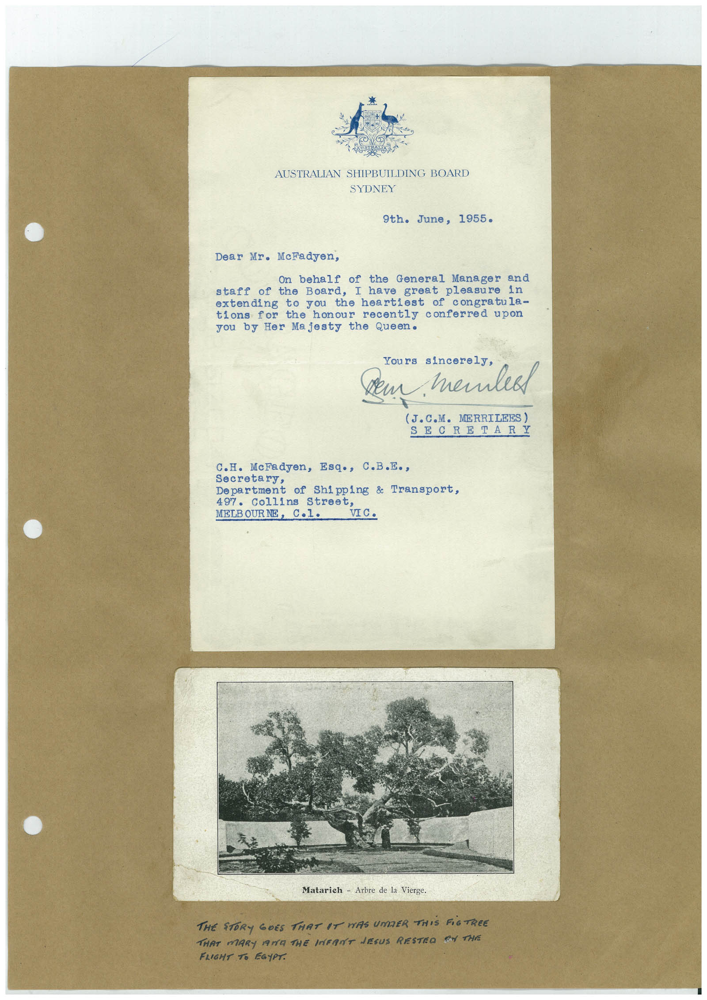

# Book 1 · scan 144

[Original scan](../../images/book-1/large/JPEG/BOOK1%20-%20145.jpg)

## Description

## Transcription

## Context

## Review notes

Compare the machine draft with the scan. Handwriting and names need human review.

## Artifacts

<!-- ARTIFACTS:START -->
Edit the artifacts field in this note’s frontmatter to change these records. This summary is generated.

### B01-S144-A01 — Letter, Photo & Handwritten note — Book 1, scan 144

Types: Typed document, Letter, Photo, Handwritten note

Scope: Whole scanned page; individual items can be split out during review.

Caption: Not mapped yet.

Caption source: Not recorded yet.

Caption status: unmapped
<!-- ARTIFACTS:END -->

## Machine transcription

<!-- OCR:START -->
AUSTRALIAN SHIPBUILDING BOARD
SYDNEY
9th. June, 1955.
Dear Mr. McFadyen,
On behalf of the General Manager and
staff of the Board, I have great pleasure in
extending to you the heartiest of congratula-
tions for the honour recently conferred upon
you by Her Majesty the Queen.
Yours sincerely,
dem memlea
(J.C.M. MERRILEES)
SECRETARY
C.H. McFadyen, Esq.,
C.B.E.,
Secretary,
Department of Shipping & Transport,
497. Collins Street,
MELB OUR NE
VIC.
Matarich - Arbre de la Vierge.
THE STORY GOES THAT IT WAS UMDER THIS FiGTREE
THAT MARY MIYA THE INFANT JESUS RESTEO ON THE
FLIGHT TO EGYPT.
<!-- OCR:END -->
