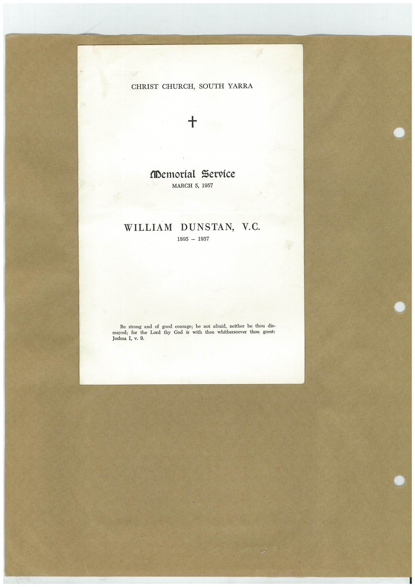

# Book 1 · scan 145

[Original scan](../../images/book-1/large/JPEG/BOOK1%20-%20146.jpg)

## Description

## Transcription

## Context

## Review notes

Compare the machine draft with the scan. Handwriting and names need human review.

## Artifacts

<!-- ARTIFACTS:START -->
Edit the artifacts field in this note’s frontmatter to change these records. This summary is generated.

### B01-S145-A01 — Printed material — Book 1, scan 145

Types: Printed material

Scope: Whole scanned page; individual items can be split out during review.

Caption: Not mapped yet.

Caption source: Not recorded yet.

Caption status: unmapped
<!-- ARTIFACTS:END -->

## Machine transcription

<!-- OCR:START -->
CHRIST CHURCH, SOUTH YARRA
+
Memorial Service
MARCH 5, 1957
WILLIAM DUNSTAN, V.C.
1895 - 1957
Be strong and of good courage; be not afraid, neither be thou dis-
thy
with thee whithersoever thou goest:
mayed; for
the
Joshua I, v. 9.
<!-- OCR:END -->
