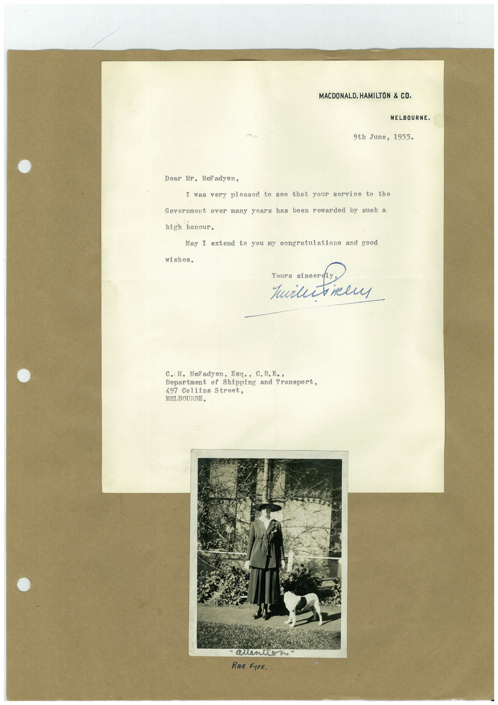

# Book 1 · scan 146

[Original scan](../../images/book-1/large/JPEG/BOOK1%20-%20147.jpg)

## Description

## Transcription

## Context

## Review notes

Compare the machine draft with the scan. Handwriting and names need human review.

## Artifacts

<!-- ARTIFACTS:START -->
Edit the artifacts field in this note’s frontmatter to change these records. This summary is generated.

### B01-S146-A01 — Letter & Photo — Book 1, scan 146

Types: Typed document, Letter, Photo

Scope: Whole scanned page; individual items can be split out during review.

Caption: Not mapped yet.

Caption source: Not recorded yet.

Caption status: unmapped
<!-- ARTIFACTS:END -->

## Machine transcription

<!-- OCR:START -->
MACDONALD, HAMILTON & CO.
MELBOURNE.
9th June, 1955.
Dear Mr. MeFadyen,
I was very pleased to see that your service to the
Government over many years has been rewarded by
high honour.
such a
May I extend to you my congratulations
and good
wishes.
Yours sineer
Хилитікем
C. H. Meladyen, Esq., C. B.E.,
Department
of
Shipping and Transport,
497 Collins Street,
MELBOURNE.
"Quenti
RRE FYFE.
<!-- OCR:END -->
