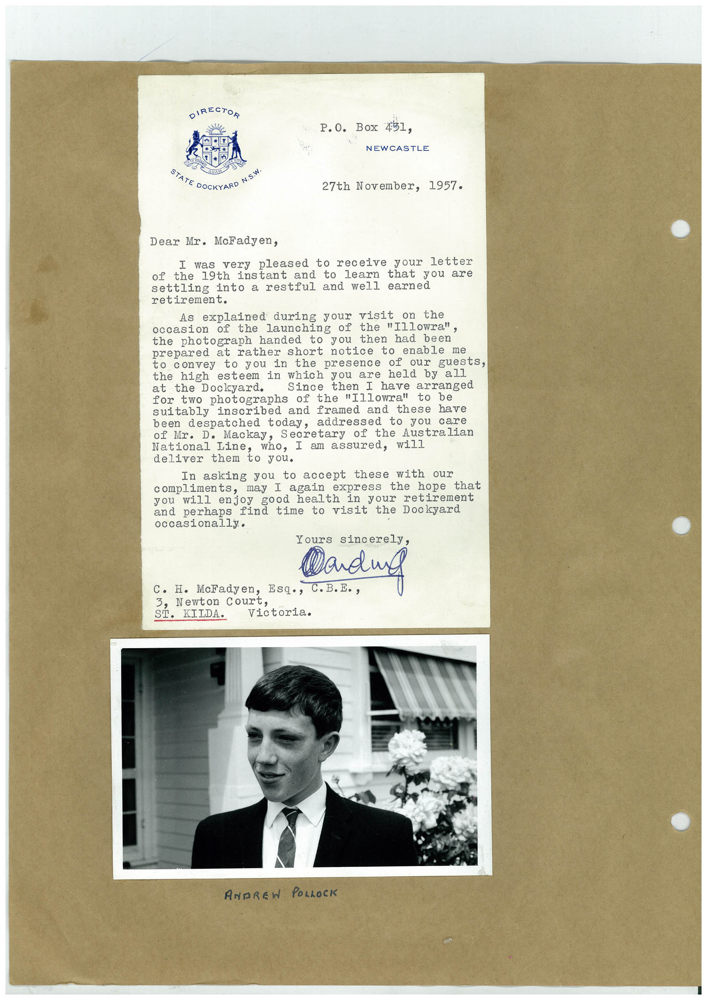

# Book 1 · scan 147

[Original scan](../../images/book-1/large/JPEG/BOOK1%20-%20148.jpg)

## Description

## Transcription

## Context

## Review notes

Compare the machine draft with the scan. Handwriting and names need human review.

## Artifacts

<!-- ARTIFACTS:START -->
Edit the artifacts field in this note’s frontmatter to change these records. This summary is generated.

### B01-S147-A01 — Letter & Photo — Book 1, scan 147

Types: Typed document, Letter, Photo

Scope: Whole scanned page; individual items can be split out during review.

Caption: Not mapped yet.

Caption source: Not recorded yet.

Caption status: unmapped
<!-- ARTIFACTS:END -->

## Machine transcription

<!-- OCR:START -->
DIRECTOR
P.O. Box 451,
NEWCASTLE
STATE DOCKYARD N.SW.
27th November, 1957.
Dear Mr. McFadyen,
I was very pleased to receive your letter
of the 19th instant and to learn that you are
settling into a restful and well earned
retirement.
As explained during your visit on the
occasion of the launching of the "Illowra",
the photograph handed to you then had been
prepared at rather short notice to enable me
to convey to you in the presence of our guests,
the high esteem in which you are held by all
at the Dockyard.
Since then I have arranged
for two photographs of the "Illowra" to be
inscribed and framed and these have
been despatched today,
addressed to you care
of Mr. D. Mackay, Secretary of the Australian
Tineto you.
who, I am assured, will
In asking you to accept these with our
compliments, may I again express the hope that
good health in your retirement
and perhaps find time to visit the Dockyard
occasionally.
Yours sincerely,
C• H• McFadyen,
Esq., C.B.E.
3, Newton Court,
ST. KILDA.
Victoria.
ANDREW POLLOCK
<!-- OCR:END -->
