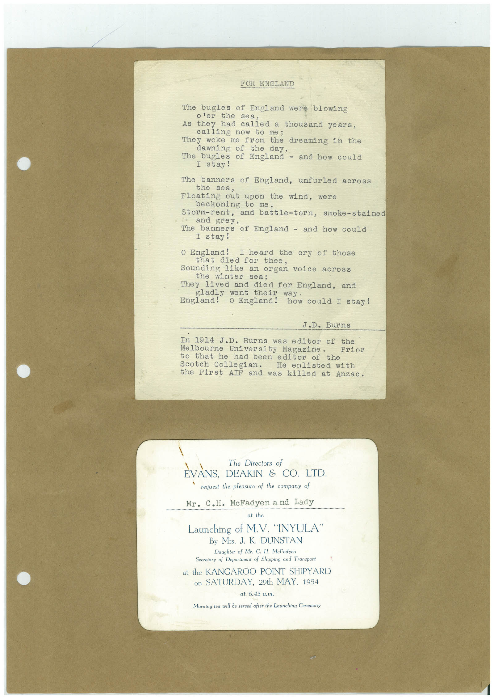

# Book 1 · scan 148

[Original scan](../../images/book-1/large/JPEG/BOOK1%20-%20149.jpg)

## Description

## Transcription

## Context

## Review notes

Compare the machine draft with the scan. Handwriting and names need human review.

## Artifacts

<!-- ARTIFACTS:START -->
Edit the artifacts field in this note’s frontmatter to change these records. This summary is generated.

### B01-S148-A01 — Typed document & Printed material — Book 1, scan 148

Types: Typed document, Printed material

Scope: Whole scanned page; individual items can be split out during review.

Caption: Not mapped yet.

Caption source: Not recorded yet.

Caption status: unmapped
<!-- ARTIFACTS:END -->

## Machine transcription

<!-- OCR:START -->
FOR ENGLAND
The bugles of England were blowing
o'er the sea,
As they had called a thousand years,
calling now to me;
They woke me from the dreaming in the
dawning of the day,
The bugles of England
- and how could
I stay!
The banners of England, unfurled across
the sea,
Floating out upon the wind, were
beckoning to me
Storm-rent, and battle-torn, smoke-stained
and grey,
The banners of England - and how could
I stay!
O England! I heard the cry
of those
that died for thee,
Sounding like an organ voice across
the winter sea;
They lived and died for England, and
gladly went their
way.
England!
O England! how could I stay!
J.D. Burns
In 1914 J.D. Burns was editor of the
Melbourne University Magazine.
to that he had been editor
Scotch Collegian.
He enlisted with
the First AIF and was killed at Anzac.
The Directors of
EVANS, DEAKIN & CO. LTD.
request the pleasure of the company of
Mr. C.H. McFadyen a nd Lady
at the
Launching of M.V. "INYULA"
By Mrs. J. K. DUNSTAN
Daughter of Mr. C. H. McFadyen
Secretary of Department of Shipping and Transport
at the KANGAROO POINT SHIPYARD
on SATURDAY, 29th MAY, 1954
at 6.45 a.m.
Morning tea will be served after the Launching Ceremony
<!-- OCR:END -->
