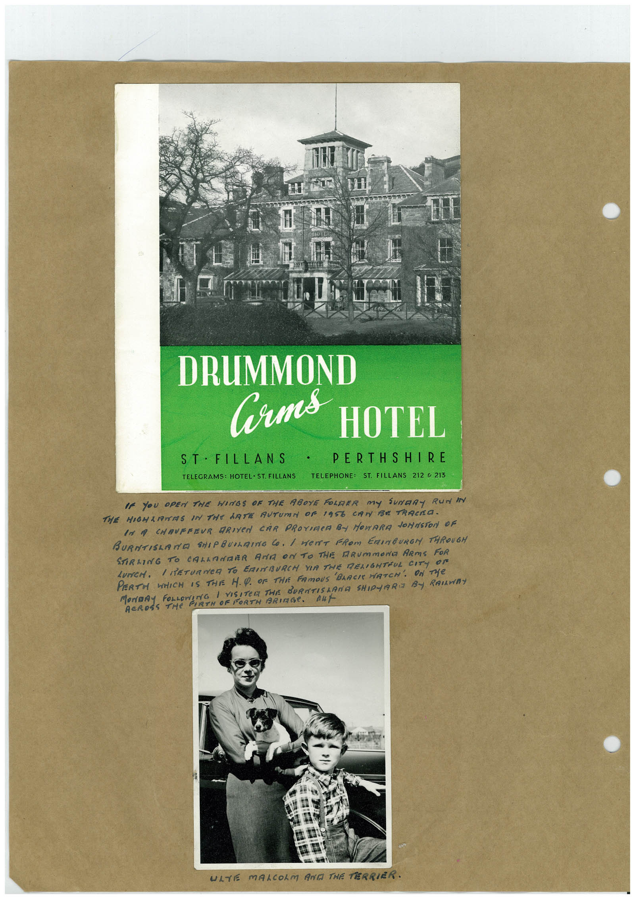

# Book 1 · scan 149

[Original scan](../../images/book-1/large/JPEG/BOOK1%20-%20150.jpg)

## Description

## Transcription

## Context

## Review notes

Compare the machine draft with the scan. Handwriting and names need human review.

## Artifacts

<!-- ARTIFACTS:START -->
Edit the artifacts field in this note’s frontmatter to change these records. This summary is generated.

### B01-S149-A01 — Newspaper clipping, Photo & Handwritten note — Book 1, scan 149

Types: Newspaper clipping, Photo, Handwritten note

Scope: Whole scanned page; individual items can be split out during review.

Caption: Not mapped yet.

Caption source: Not recorded yet.

Caption status: unmapped
<!-- ARTIFACTS:END -->

## Machine transcription

<!-- OCR:START -->
УД ВІМ В
DRUMMOND
Gorms HOTEL
ST • FILLANS •
PERTHSHIRE
TELEGRAMS: HOTEL • ST. FILLANS TELEPHONE: ST. FILLANS 212 € 213
IF YOU OPEN THE WINGS OF THE ABOYE FOLDER MY SUNGRY RUN IN
THE HIGHARIAS IN THE LATE AUTUMN OF 1956 CAT BE TRACKO.
IN A CHAUFFEUR DRIVeN CAR PROYIMER BY MOVARA JOHNSTON OF
BURNTISLANG SHIPBUNLAING CO. I HeRT FROM ERINBURGH THROUGH
STIRRING TO CALAMADER ANA ON TO THE DRUmmONa ARMS FOR
LUNCH, / NETURNER TO ERNBURCH YIR THE RELIGHTFUL CITY OF
PERTH WHICH IS THE H.Q. OF THE FAmOUS
MACROY FOR A VISITE TA BUTSARN SHIPLARBY RANNY
ULTE MALCOLM AND THE TERRIER.
<!-- OCR:END -->
