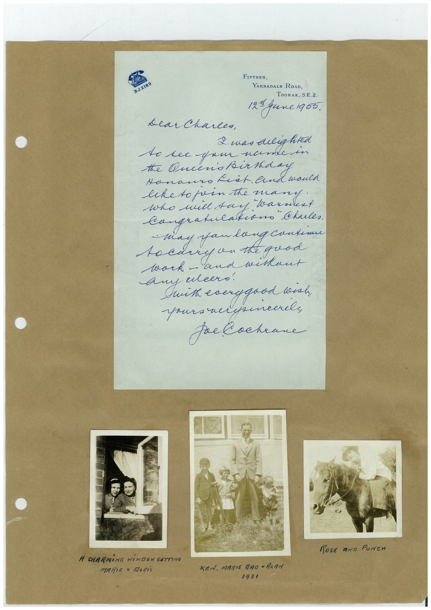

# Book 1 · scan 150

[Original scan](../../images/book-1/large/JPEG/BOOK1%20-%20151.jpg)

## Description

## Transcription

## Context

## Review notes

Compare the machine draft with the scan. Handwriting and names need human review.

## Artifacts

<!-- ARTIFACTS:START -->
Edit the artifacts field in this note’s frontmatter to change these records. This summary is generated.

### B01-S150-A01 — Letter, Photo & Handwritten note — Book 1, scan 150

Types: Letter, Photo, Handwritten note

Scope: Whole scanned page; individual items can be split out during review.

Caption: Not mapped yet.

Caption source: Not recorded yet.

Caption status: unmapped
<!-- ARTIFACTS:END -->

## Machine transcription

<!-- OCR:START -->
BJ 2189
FIFTEEN,
YARRADALE ROAD,
TOORAK, S.E. 2.
121 fune 1955.
dear Charles,
2 was delighted
10 see yan namer
the Queens Birda
tanano rat. and would
liketo fein the many.
Who will say Warmest
"Charles.
may fau lang conteme
acary an the good
lark -
and weekaut
With everygood unh
Fee Cockrane
POSE AND PUNCH
A CHARMiNG WINDOW SETTiNG
MARIE a MORiS
KEN. MARIE DAD • ALAN
1931
<!-- OCR:END -->
