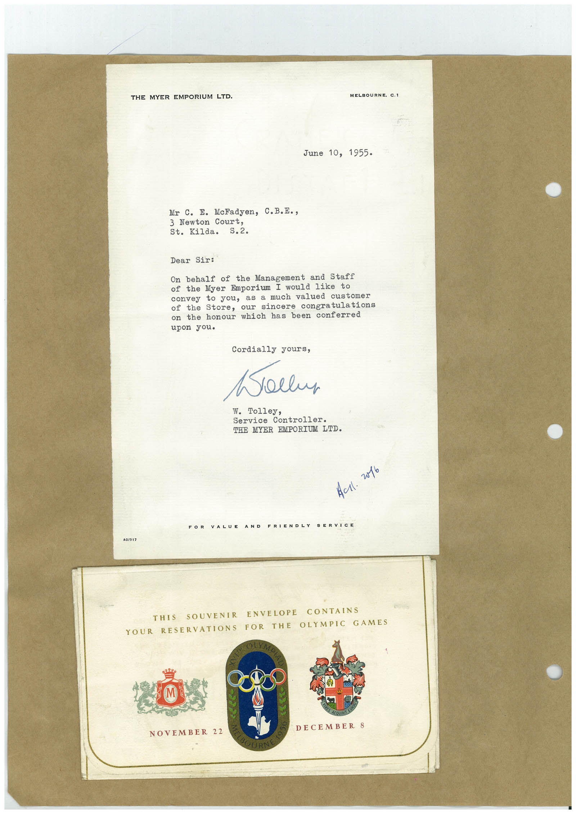

# Book 1 · scan 151

[Original scan](../../images/book-1/large/JPEG/BOOK1%20-%20152.jpg)

## Description

## Transcription

## Context

## Review notes

Compare the machine draft with the scan. Handwriting and names need human review.

## Artifacts

<!-- ARTIFACTS:START -->
Edit the artifacts field in this note’s frontmatter to change these records. This summary is generated.

### B01-S151-A01 — Letter & Greeting card — Book 1, scan 151

Types: Typed document, Letter, Greeting card

Scope: Whole scanned page; individual items can be split out during review.

Caption: Not mapped yet.

Caption source: Not recorded yet.

Caption status: unmapped
<!-- ARTIFACTS:END -->

## Machine transcription

<!-- OCR:START -->
THE MYER EMPORIUM LTD.
MELBOURNE. C.1
June 10, 1955•
Mr C. E. McFadyen, C.B.E.,
3 Newton Court,
St. Kilda.
S.2.
Dear Sir:
On behalf of the Management
and Staff
of the Myer Emporium I would like to
to you, as a much valued customer
Store, our sincere congratulations
on the honour which has
been conferred
upon you.
Cordially yours,
Kollus
W. Tolley,
Service Controller.
THE MYER EMPORIUM LTD.
Aul.
v016
FOR
LY
AO/317
THIS SOUVENIR
ENVELOPE CONTAINS
YOUR RESERVATIONS FOR THE OLYMPIC GAMES
DECEMBER 8
NOVEMBER
<!-- OCR:END -->
