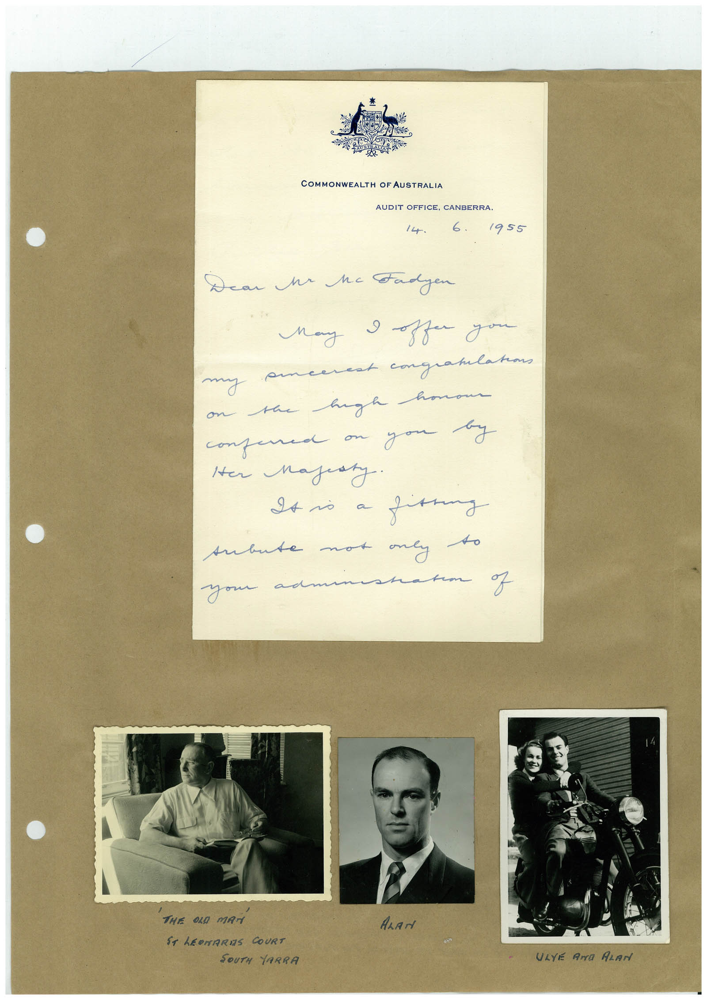

# Book 1 · scan 152

[Original scan](../../images/book-1/large/JPEG/BOOK1%20-%20153.jpg)

## Description

## Transcription

## Context

## Review notes

Compare the machine draft with the scan. Handwriting and names need human review.

## Artifacts

<!-- ARTIFACTS:START -->
Edit the artifacts field in this note’s frontmatter to change these records. This summary is generated.

### B01-S152-A01 — Letter, Photo & Handwritten note — Book 1, scan 152

Types: Letter, Photo, Handwritten note

Scope: Whole scanned page; individual items can be split out during review.

Caption: Not mapped yet.

Caption source: Not recorded yet.

Caption status: unmapped
<!-- ARTIFACTS:END -->

## Machine transcription

<!-- OCR:START -->
COMMONWEALTH OF AUSTRALIA
AUDIT OFFICE, CANBERRA.
14.
6.
1955
Dear Me he Fadyen
May I offer you
my -
merest congratulations
on the hugh hon
confered on you by
Her Majesty.
It no a fanny
subute not oney to
your as
sharm of
THE OLD MAN
ST LEONARAS COURT
SOUTH YARRA
ALAN
ULYÉ AND ALAM
<!-- OCR:END -->
