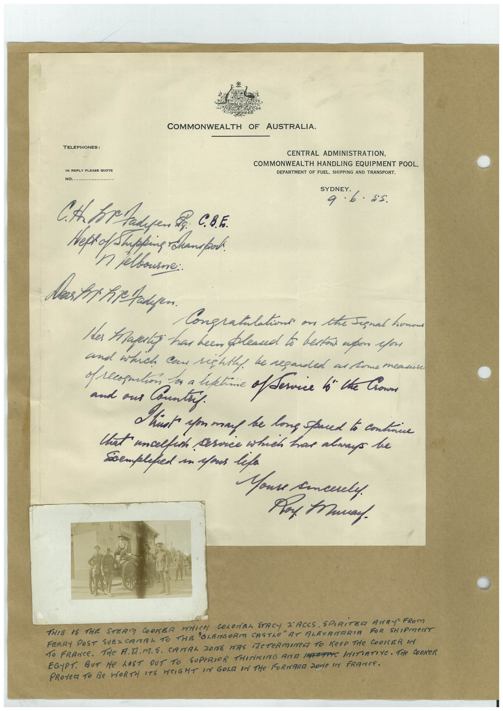

# Book 1 · scan 153

[Original scan](../../images/book-1/large/JPEG/BOOK1%20-%20154.jpg)

## Description

## Transcription

## Context

## Review notes

Compare the machine draft with the scan. Handwriting and names need human review.

## Artifacts

<!-- ARTIFACTS:START -->
Edit the artifacts field in this note’s frontmatter to change these records. This summary is generated.

### B01-S153-A01 — Letter, Photo & Handwritten note — Book 1, scan 153

Types: Letter, Photo, Handwritten note

Scope: Whole scanned page; individual items can be split out during review.

Caption: Not mapped yet.

Caption source: Not recorded yet.

Caption status: unmapped
<!-- ARTIFACTS:END -->

## Machine transcription

<!-- OCR:START -->
COMMONWEALTH OF AUSTRALIA.
TELEPHONES:
IN REPLY PLEASE QUOTE
....
CENTRAL ADMINISTRATION,
COMMONWEALTH HANDLING EQUIPMENT POOL,
DEPARTMENT OF FUEL, SHIPPING AND TRANSPORT,
SYDNEY.
9 6. 85
Heps of Shipping Champo
п неввоте::
Congratilations on the Signal home
Has tape has been plead to bestos upon your
and which can rightly, he regarded an home mean
repution a a lettie offerice to the Come
and ons Country.
Think on ma be long spred to condie
that uncelfish sorce which has always ke
seempleped is spous life
Youre cancely.
Pay taway.
THIS IS THE STERN COOKER WHICH COLOrRA STACY D'ACES, SPIRITER AWAY" FRom
FERRY POST SUEZCANAL TO THE "GLENGORM CASTLE" AT ALRIANTRIA FOR SHIPMENT
To FRANCe. THe A.D.M.S. CANAL ZONE WAS ACTeRmINe TO KeeP THe COOKER INt
EGYPT. BUT He LOST OUT TO
SUPERIOR THINKING AND INFRITIC INITIATIVE. THe COOKER
PROVEM TO Be WORTH ITS WeIGHT IN GOL IN THe FORwARa 2ode In FRANCe.
<!-- OCR:END -->
