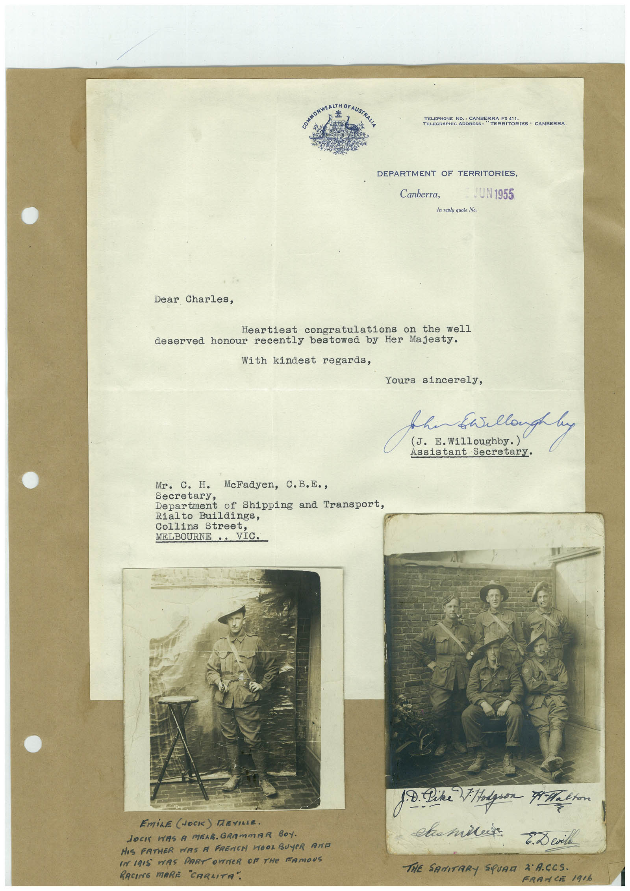

# Book 1 · scan 154

[Original scan](../../images/book-1/large/JPEG/BOOK1%20-%20155.jpg)

## Description

## Transcription

## Context

## Review notes

Compare the machine draft with the scan. Handwriting and names need human review.

## Artifacts

<!-- ARTIFACTS:START -->
Edit the artifacts field in this note’s frontmatter to change these records. This summary is generated.

### B01-S154-A01 — Letter, Photo & Handwritten note — Book 1, scan 154

Types: Typed document, Letter, Photo, Handwritten note

Scope: Whole scanned page; individual items can be split out during review.

Caption: Not mapped yet.

Caption source: Not recorded yet.

Caption status: unmapped
<!-- ARTIFACTS:END -->

## Machine transcription

<!-- OCR:START -->
TELEPHONE NO.: CANBERRA F0 411
"TERRITORIES " CANBERRA
DEPARTMENT OF TERRITORIES,
Canberra,
JUN 1955
In reply quote No.
Dear Charles,
Heartiest congratulations on the well
deserved honour recently bestowed by Her Majesty.
With kindest regards,
Yours sincerely,
Assistant Secretary.
Mr. C. H. McFadyen, C.B.E.,
Department of Shipping and Transport,
Rialto Buildings,
Collins Street,
MELBOURNE.. VIC.
EmiLE JOCK) DEVILLE.
JOCI WAS A MELB. GRAmmAR BOY.
HIS FATHER WAS A FRENCH WOOL BUYER AND
IN I9I5 WAS PART OUTER OF THe FAMOUS
RACING MARE "CARLITA".
18. Dike Podgion Meet
світіня
E. D evil
THE SANITARY SQUAM 2 ACCS.
FRAMCE 1916
<!-- OCR:END -->
