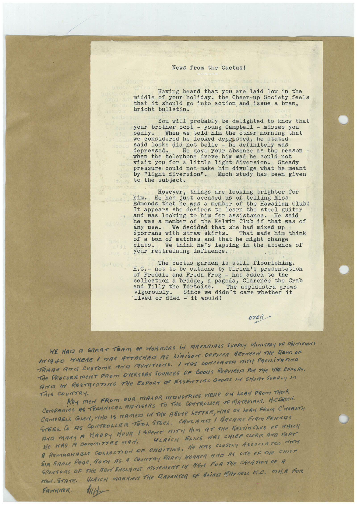

# Book 1 · scan 155

[Original scan](../../images/book-1/large/JPEG/BOOK1%20-%20156.jpg)

## Description

## Transcription

## Context

## Review notes

Compare the machine draft with the scan. Handwriting and names need human review.

## Artifacts

<!-- ARTIFACTS:START -->
Edit the artifacts field in this note’s frontmatter to change these records. This summary is generated.

### B01-S155-A01 — Letter & Handwritten note — Book 1, scan 155

Types: Typed document, Letter, Handwritten note

Scope: Whole scanned page; individual items can be split out during review.

Caption: Not mapped yet.

Caption source: Not recorded yet.

Caption status: unmapped
<!-- ARTIFACTS:END -->

## Machine transcription

<!-- OCR:START -->
News from the Cactus!
Having heard that you are laid low in the
middle of your holiday,
the Cheer-up Society feels
that it should go into action and issue a braw,
bricht bulletin.
You will probably be delighted to know that
your brother Scot - young Campbell - misses you
When we told him the other morning that
we considered he looked depressed, he stated
said looks did not belie - he definitely was
depressed.
He gave your absence as the reason -
telephone drove him mad he could not
visit you for a little light diversion.
pressure could not make him divulge what he meant
by "light diversion".
Much study has been given
to the subject.
However, things are looking brighter for
him. He has
just accused us of telling Miss
Edmonds that he was a member of the Hawaiian Club!
It appears she desires to learn the steel guitar
and was looking to him for assistance.
he was a member of the Kelvin Club if that was of
We decided that she had mixed up
sporrans with straw skirts.
That made him think
of a box of matches and that he might change
We think he's lapsing in the absence of
your restraining influence.
The cactus garden is still flourishing.
H.C. - not to be outdone
by Ulrich's presentation
of Freddie and Freda Frog - has added to the
collection a bridge,
a pagoda, Clarence the Crab
and Tilly the Tortoise.
vigorously.
The
aspidistra grows
Since we
didn't care whether it
• lived or died - it would!
OVER
WE NAD A GREAT TRAM OF WORKERS IN MATERIAAS SUPPLY MINISTRY OF MINITIONS
IGNO MHERE / MAS ATTACHER AS LiAiSON OFFICER BETWeEN THe DEPT. OF
TRAME ATTA CUSTOMS ArE MUNITIONS. / HAS CONCeRTeR VITY FACILiTATING
THe PROCUREmEnT FROm OVeRSeAS SOURCeS OF GODS ReQUIRE FOR THe WAR EFFORT.
ANA MA RESTRICTING THe EXPORT OF ESSENTIAL GROS IN SHORT SUPPLY iN
THIS COUNTRY.
Key meN FROM OUR MANOR INDUSTRIES WERe ON LOAN FROM THeiR
COmPANieS AS TECHNICAL ARTISeRS TO THe CONTROLLeR OF MATeRIALS. H.C.GReEN.
CAMBRELL GLeN, WHO IS NAMER IN THe ABOYE LETTER, HAS ON LOAN FROM C'HEARTH
STEEL CO AS CONTRONLTER TOOL STEeL. CAMAME / BECAME FIRM FRIeNTIS
AAR MANY A HARDY HOUR / SPENT WITH HIM AT THe KELiNChUB OF WHICH
He WAS A CommITTEE MAN.
ULRICH ELLIS WAS CHIEF CHERIS AOR KePT
A RemARKABLe COLLECTION OF ORDiTIES, He WAS CLOSeLY ASSOCIATeD MITH
SIR EARLe PAGE, BOTH MS A COUNTRY PARTY HORNER ARE AS ONE OF THe CHIEN
SPONSORS OF THE MeN ENGARNE MOreMeNT IN NEN FOR THe CReATION OF A
ren. STATe.
ULRICH MARRIER THE RAVENTER OF BRINE GANNERA FC. MHR FOR
FAMINER.
<!-- OCR:END -->
