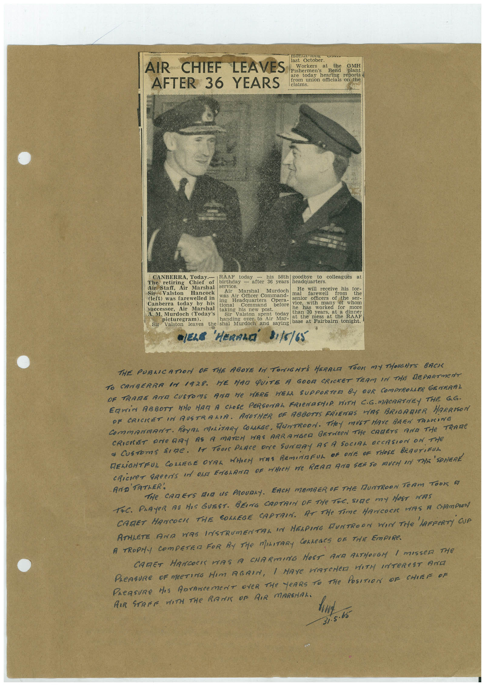

# Book 1 · scan 156

[Original scan](../../images/book-1/large/JPEG/BOOK1%20-%20157.jpg)

## Description

## Transcription

## Context

## Review notes

Compare the machine draft with the scan. Handwriting and names need human review.

## Artifacts

<!-- ARTIFACTS:START -->
Edit the artifacts field in this note’s frontmatter to change these records. This summary is generated.

### B01-S156-A01 — Newspaper clipping & Handwritten note — Book 1, scan 156

Types: Newspaper clipping, Handwritten note

Scope: Whole scanned page; individual items can be split out during review.

Caption: Not mapped yet.

Caption source: Not recorded yet.

Caption status: unmapped
<!-- ARTIFACTS:END -->

## Machine transcription

<!-- OCR:START -->
AIR CHIEF LEAVES
AFTER 36 YEARS
monur-Jung
Tackobes
Workers
at
the
His Hereas
Bend
GMH
today
hearing reports
from union officials on the
2huaes
CANBERRA, Today.—
RAAF today
his 58th goodbye
to colleagues
The
retiring
Chief
of
birthday
Air Staff,
Air Marshal
service.
- alter 36 years
headquarters.
Sir Valston
Hancock
Air
Marshal
Murdoch
He will receive his tor-
was Air Officer Command-
mal
farewell
(left) was farewelled in
Canberra today by his
ing
Headquarters
Opera-
senior officers of the
tional
Command
successor,
before
Air
Marshal
taking as new
post.
vice hasi
with
many of
ser-
whom
worked
A. M. Murdoch (Today's
Sir Valston spent today
than 30 years,
for
more
at a dinner
picturegram).
handing over to
Air Mar-
at the
mess
at the RAAF
Sir Valston
leaves the shal Murdoch and saying base at Fairbairn tonight.
•ELE 'HERALD'
31/8/65
THE PUBLICATION OF THE ABOYE IN TONIGHTS HERALD TOOK MY THOUGHTS BACK
TO CANBERRA IN 1928. HE HAD QUITE A GOOD CRICKET TEAM IN THE DEPARTMENT
OF TRAME ANT CUSTOMS AND ME HERE HELL SUPPORTER BY OUR COMPTROLAER GENERAL
COmMANmANT. ROyAL MOLiTARy COLARSe, HUNTROON. THeY MUST HAVe BREN TANKING
CRICKET ONE RAY AS A MATCH HAS ARRANGCA BETWeEN THe CARETS AND THe TRAMe
* CUSTomS SIRe. IT TOO PLACE DNe SUNRY AS A SOCIAL OCCASION ON THe
RELIGHTFUL COLLEGE OVAL WHEN WAS REMINAFUL OF ONE OF THOSE BEAUTIRUL
CRiCKET GReeNS IN ON ENGLAND DE MHICH WE REAR AND SEE SO MUCH IN THE SPHERE
'TATER',
THe CARETS MIR US PROUDAY. EACH MEMBER OF THE MUNTROON TeAM TOON A
TAC. PLAYER AS HIS GUEST. BEING CAPTRIN OF THe TiC. SIGE mY HOST HAS
CATET HANCOCK THE COLLEGE CAPTAIN. AT THe TiMe HANCOCK VIS A CHAMPION
ATHLETE AND WAS INSTRUMENTAL IN MELPING HUNTROON WIN THe LAFFERTY GUA
A TROPHY COMPETER FOR BY THe MILITARY COLLEGES OF THE EmPIRe.
CARRET HANCOCI WAS A CHARMING HOST ANA RATHOUGM I MISSER THE
PLeASURE OF MEETING HIM AGAIN, I HAYe WATCHED WITH INTEReST AND
PAEASURe HIS DOrANCEMeNT OVeR THe YeARS TO THE POSITION OF CHIEF OF
AIR STARE WITH THE RANI OF AIR MARSHAL.
. 65
<!-- OCR:END -->
