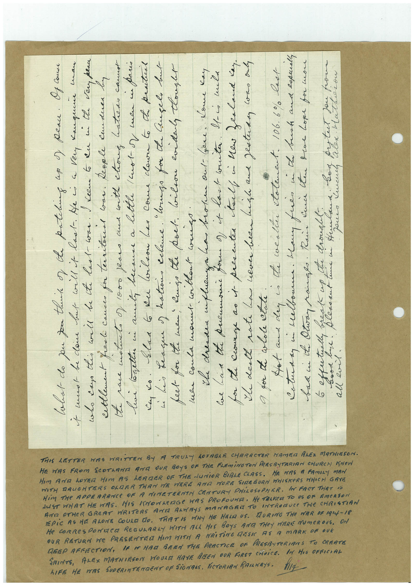

# Book 1 · scan 157

[Original scan](../../images/book-1/large/JPEG/BOOK1%20-%20158.jpg)

## Description

## Transcription

## Context

## Review notes

Compare the machine draft with the scan. Handwriting and names need human review.

## Artifacts

<!-- ARTIFACTS:START -->
Edit the artifacts field in this note’s frontmatter to change these records. This summary is generated.

### B01-S157-A01 — Letter & Handwritten note — Book 1, scan 157

Types: Letter, Handwritten note

Scope: Whole scanned page; individual items can be split out during review.

Caption: Not mapped yet.

Caption source: Not recorded yet.

Caption status: unmapped
<!-- ARTIFACTS:END -->

## Machine transcription

<!-- OCR:START -->
hIFE HE MAS
SUDERINTENGENT OF SiGNERAS, ViCTORIAN RAILKAYS.
SAINTS, ALEX MATHIRSON HOUR HAVE BEEN OUR FIRST CHOiCE. IN HIS OFFICIAL
REEP ERECTION, 1E IT MAG BERM THE PRACTICE OF PRESBITeRIANS TO CREATE
OUR RETURN We PRESENTER HIM WITH A KRiTiNG RESI AS A MARK DF OUR
He CORReSPONDeR ReGULARLY WITH ALL HIS BOYS AND THeY MIERE NUmeROUs. ON
EPIC AS HE ALONE COULE DO. THAT IS HINY HE HALT US. TAURING THe MAR OF 1914-18
JUST WHAT HE WAS. HIS IMMONAGe WAS PROFOUNE. He TALKeR TO US OF EmeRSON
AND OTHER GREAT WRITERS ANTA ALMAYS MANAGER TO INTRODUCE THE CHRISTIAN
HIM THe APDERRANCE OF A NIMETEENTA CENTURY PHiLOSOPMER. IN FACT TriAT IS
HIM AND LOVE HIM AS LEADER OF THE JUNiOR BIBLE CLASS.
WITH DAUGHTERS OLDER THAN WE WERE AMA MORE SIDEBURN HHISKERS WHICH GAYE
He was a FAmiLy mAN
HE WAS FROM SCOTAANI AND OUR BOYS OF THE FLEMiNGTON PRESBYTRRIAN CHURCH Krew
THIS LETTER WAS WRITTEN BY A TRULY LOVABLE CHARACTER MAMEN ALES MATHIESON.
Chat- do you for thunt of te pateling as ) Peace. Of conse
i muot be da but will i last. He is a Very Kangune man
who cao this will be de laal- was. keem to ku mi the ven peac
settlement fast came for territonal war. Reople knuduer by
the pace motto of 1000 fears and with choug hatress cannot
lui letter ni anil, became a little Inot-or men in paris
Ko. Slaa 6 ku lileon han come clawra to te practil
his League ) kation echeme. "hungo for de Guşelı but
feet for the men, cungo the poet. Wilon eviden tlought
men coula want without weiss.
the dresses influenza ba broken out- Giene. Kome kay
Coe his the premonic for of it lact write. It-co mili
for the conse as it presenter tall in new Zealand kay.
I death nate has never been high and festerday cowo only
gor de colole atale.
bad i the Otra ranges. Rain kid ten Doe Lope for mon
all evil.
<!-- OCR:END -->
