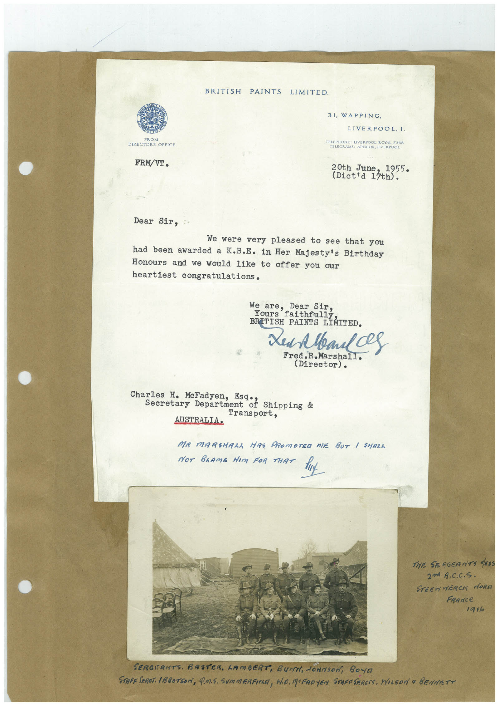

# Book 1 · scan 158

[Original scan](../../images/book-1/large/JPEG/BOOK1%20-%20159.jpg)

## Description

## Transcription

## Context

## Review notes

Compare the machine draft with the scan. Handwriting and names need human review.

## Artifacts

<!-- ARTIFACTS:START -->
Edit the artifacts field in this note’s frontmatter to change these records. This summary is generated.

### B01-S158-A01 — Letter, Photo & Handwritten note — Book 1, scan 158

Types: Typed document, Letter, Photo, Handwritten note

Scope: Whole scanned page; individual items can be split out during review.

Caption: Not mapped yet.

Caption source: Not recorded yet.

Caption status: unmapped
<!-- ARTIFACTS:END -->

## Machine transcription

<!-- OCR:START -->
BRITISH PAINTS LIMITED.
FROM
DIRECTORS GREECE
FRM/VI.
31, WAPPING,
LIVERPOOL, I.
TELEPHONE: LIVERPOOL ROYAL 7368
TELEGRAMS: APEXIOR, LIVERPOOL
20th June
1955
(Dict'd 13th).
Dear Sir,
We were very pleased to see that you
had been awarded a K.B.E. in Her Majesty's Birthday
Honours and we would like to offer you our
heartiest congratulations.
We
Dear Sir,
Yours
ars falth ully
BRITISH PAINTS LIMITED.
Xed Meals
Fred.R.Marshall.
(Director).
Charles H. McFadyen, Esq: Shipping &
Secretary Department
Transport,
AUSTRALIA•
MR MARSHALA HAS PROMOTER DIE BUT / SHALL
NOT BRamA dIm FOR THAT Hu
THE SERGEANTS MESS
2m A.C.C.S.
STEENMERCK MORA
FRance
1916
SERGERNTS. BASTER. GAMBERT, BurN, JOHNson, BOya
STAFF SEROT. ABBOTSON, 4.M.S. SUMMERFIELD, WD. MOFADYEN STAFFSERETS, WILSON a BENNETT
<!-- OCR:END -->
