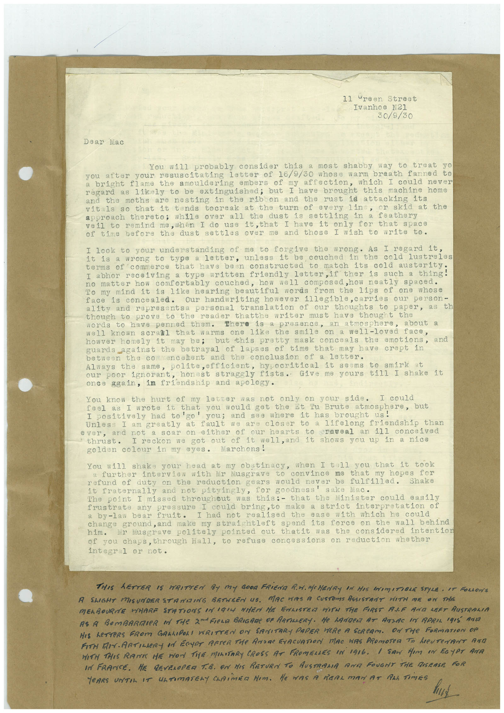

# Book 1 · scan 160

[Original scan](../../images/book-1/large/JPEG/BOOK1%20-%20161.jpg)

## Description

## Transcription

## Context

## Review notes

Compare the machine draft with the scan. Handwriting and names need human review.

## Artifacts

<!-- ARTIFACTS:START -->
Edit the artifacts field in this note’s frontmatter to change these records. This summary is generated.

### B01-S160-A01 — Typed document — Book 1, scan 160

Types: Typed document

Scope: Whole scanned page; individual items can be split out during review.

Caption: Not mapped yet.

Caption source: Not recorded yet.

Caption status: unmapped
<!-- ARTIFACTS:END -->

## Machine transcription

<!-- OCR:START -->
11 ureen Street
Ivanhoe N21
30/9/30
Dear Mac
You will probably consider this a most shabby
way to treat yo
you after your resuscitating letter of 16/9/30 whose warm
breath fanned to
a bright flame the smouldering embers of my affection, which I could
never
régard as likely to be extinguished; but I have brought this machine home
and the moths are nesting in the ribon and the rust id attacking
its
vitals so that it tends tocreak at the turn of every line, or skid at the
approach thereto; while over all the dust is settling in a feathery
veil to remind me, when I do use it,that I have it only for that space
of time before the dust settles over me and those I wish to write to.
I look to your understanding
of me
to forgive the wrong. As I regard it,
it is a wrong to type a letter, unless it be couched in
the cold lustreles
terms of commerce that have been constructed to match its cold austerity.
I abhor receiving a type written friendly letter, if ther is such a thing!
no matter how comfortably couched, how well composed,how neatly spaced.
To my mind it is like hearing beautiful words from the lips of one whose
face is concealed.
Our handwriting however illegible, carries our person-
ality and representsa personal translation of our
thoughts to paper, as th
though to prove to the reader thatthe writer must have thought the
words to have penned them.
there is a presence, an atmosphere,
Nell known scrall that warms one like the smile on a well-loved face,
howver homely it may be;
but this pretty mask conceals the emotions,
guards against the betrayal of lapses of time that may have crept in
between the co mencanent
and the conclusion of a letter.
Always the same, polite, efficient, hypocritical it seems to smirk
Our
poor ignorant, honest straggly fists. Give me yours till I shake it
once again, in friendship and apology.
You know the hurt
of my letter was not only on your side.
feel as
I wrote it that you would got the st Iu Brute atmosphere, but
I positively had to'go' you; and see where it has
brought us!
Unless I am greatly at fault we are closer to a lifelong friendship than
ever, and not a scar on either of our hearts to craveal an ill conceived
thrust•
I reckon we got
out of it
well, and it shows you up in a nice
golden colour in my eyes. Marchons!
You will shake your head at my obstinacy, when I tell you that it took
a further interview with Mr Musgrave to
convince me that my hopes for
refund of duty on the reduction gears would
never be fulfilled.
Shake
it fraternally and not pityingly,
The point I missed throughout was this:- that the Minister could
easily
frustrate any pressura I could bring, to make a strict interpretation of
a by-law bear fruit.
ease with which he could
change ground, and make my straightleft spend its force on the wall behind
him.
Mr Masgrave politely pointed out thatit was the considered intention
of you chaps, through Hall, to refuse concessions on reduction whether
integral or not.
THIS LETTER IS WRITTEN BY MY GOOD FRIEDA R.M. MCHENRY IN HIS INIMITIBLE STYLE • IT ROLLONS
A SLIGHT MISUNDERSTAMDING BETHREN US. MAC WAS A CUSTOMS ASSISTRNT HITH ME ON THE
MELBOURNE WHARE STATIONS UNIGIG WIER HE ENLISTER WITH THE FIRST ALF AND LEFT AUSTRALIA
AS A BOMBARIER IN THE 2MFIELE BRIGARE OF ARTILLERY. HE LANDER AT ATLAC IN APRIL IRIS ANI
HIS LETTERS FROM GARLIDORI WRITTEN ON SANITARY PAPER HERE A SERCAM. ON THE FORMATION OF
FIN MAARTILERY Id ECUAT AFTeR THe ANaR FrACUATION MAC WAS PRomoTeD To heuTenT Arn
WITH THIS RATE HE MON TIE MILITARY CROSS AT FROMELLES IN 1916. / SON Hem eN EGyPT ANa
IN FRANCE. HE DEVELOPER T.B. ON HIS RETURN TO AUSTRAMA ARE FOUGNT THE DISEASE FOR
TEARS TIL IT ATIMATELY CLAiMED HIM. He WAS A REAL MAN AT ALL TiMES
<!-- OCR:END -->
