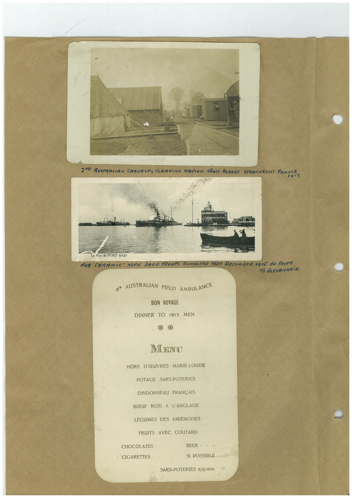

# Book 1 · scan 161

[Original scan](../../images/book-1/large/JPEG/BOOK1%20-%20162.jpg)

## Description

## Transcription

## Context

## Review notes

Compare the machine draft with the scan. Handwriting and names need human review.

## Artifacts

<!-- ARTIFACTS:START -->
Edit the artifacts field in this note’s frontmatter to change these records. This summary is generated.

### B01-S161-A01 — Photo & Handwritten note — Book 1, scan 161

Types: Photo, Handwritten note

Scope: Whole scanned page; individual items can be split out during review.

Caption: Not mapped yet.

Caption source: Not recorded yet.

Caption status: unmapped
<!-- ARTIFACTS:END -->

## Machine transcription

<!-- OCR:START -->
2N° RUSTRALIAN CASURATY CLEARING STATION TROIS ARBRES STEENWERCIS FRANCE
1917
Le Port de PORT SAID
THE CERAMIC MITH 3000 TROOPS ANCHORCA HERe RECEMBeR 1915 EN Roure
TO PLEXANARiA.
8! AUISTRALIAN FIELD AMBULANCE
BON VOYAGE
DINNER TO 1915
MEN
MENU
HORS D'ŒUVRES MARIE-LOUISE
POTAGE SARS-POTERIES
DINDONNEAU FRANÇAIS
BŒUF ROTI A L'ANGLAISE
LÉGUMES DES AMIENOISES
FRUITS AVEC COUTARD
CHOCOLATES
BEER - - -
CIGARETTES -
SI POSSIBLE
SARS-POTERIES 8/2/1919.
<!-- OCR:END -->
