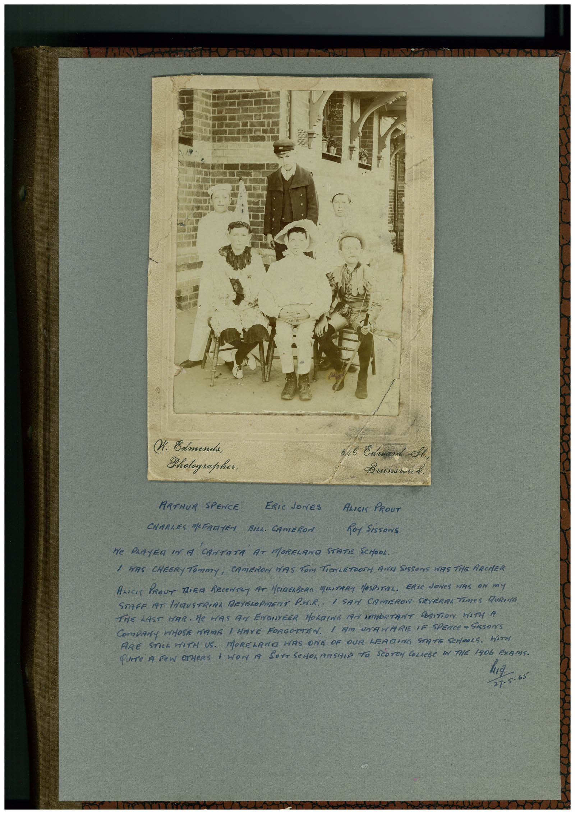

# Book 1 · scan 162

[Original scan](../../images/book-1/large/JPEG/BOOK1%20-%20163.jpg)

## Description

## Transcription

## Context

## Review notes

Compare the machine draft with the scan. Handwriting and names need human review.

## Artifacts

<!-- ARTIFACTS:START -->
Edit the artifacts field in this note’s frontmatter to change these records. This summary is generated.

### B01-S162-A01 — Photo & Handwritten note — Book 1, scan 162

Types: Photo, Handwritten note

Scope: Whole scanned page; individual items can be split out during review.

Caption: Not mapped yet.

Caption source: Not recorded yet.

Caption status: unmapped
<!-- ARTIFACTS:END -->

## Machine transcription

<!-- OCR:START -->
W. Edmenda,
Photographer.
846 Cárard St
ARTHUR SPENCE ERiC JONES
ALICIS PROUT
CHARLES MOFARTEN BILL. CAMERON
foy Sissons
Ne PeRTEa In A
'CANTATA AT MORELANO STATE SCHOOL.
/ WAS CHEERY TOmmY, CAMERON HAS TOm TiCKLETOOTH AND SISSOrS WiS THe ARCHER
ALICK PROUT TiER RECENTLy AT HeIMERBeRG MATARY HOSPITAL.
ERIC JONeS HAS ON mY
STAFF 19T LNMUSTRIAL DEYSROPMENT PUR. I SAM CAMERON SEVERAL TIMES FURING
THE LAST HAR. He MAS AN ENGIVEER HOLDING TAr SMORTANT POSITiON WITH A
COMPANy WHOSE NAME I HAVE FORGOTTEN. I AM UNAHARE IF SPENCE " SIsSONS
ARE STILL HITH US. MORELAND HAS ONE OF OUR LEADING STATE SCrOOLS. HITH
QUITe A FEW OTHERS 1 WON A SOrT SCHOLARSHIP TO SCOTCy COLLeGe IN THE 1906 ExAMS.
27-5.65
<!-- OCR:END -->
