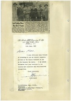

# Book 2 · scan 022

[Original scan](../../images/book-2/thumbs/chubb-book-2-022.jpg)

## Description

## Transcription

## Context

## Review notes

Compare the machine draft with the scan. Handwriting and names need human review.

## Artifacts

<!-- ARTIFACTS:START -->
Edit the artifacts field in this note’s frontmatter to change these records. This summary is generated.

### B02-S022-A01 — Newspaper clipping, Letter & Invitation — Book 2, scan 022

Types: Newspaper clipping, Letter, Invitation

Scope: Whole scanned page; individual items can be split out during review.

Caption: Not mapped yet.

Caption source: Not recorded yet.

Caption status: unmapped
<!-- ARTIFACTS:END -->

## Machine transcription

<!-- OCR:START -->
Only a thumbnail survives in this checkout; transcription deferred.
<!-- OCR:END -->
